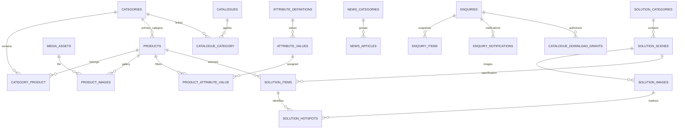

# BE-01 — Backend Architecture & Data Contract Audit

Дата аудита: 20 октября 2026 года.

Аудит выполнен по [BE-01-backend-architecture-audit.md](BE-01-backend-architecture-audit.md).

**Исследование выполнено в режиме read-only:** использовались только чтение файлов и поиск. Код, зависимости, конфигурация, БД и состояние сервисов не изменялись. Сборки, тесты, Artisan-команды, HTTP-запросы и обращения к работающей БД не выполнялись. Этот файл сохранён отдельно по последующему прямому запросу пользователя; архитектура не реализовывалась.

Обозначения:

- **Факт** — подтверждено текущими файлами.
- **Предложение** — архитектура для согласования.
- **Неизвестно** — доступных исходников недостаточно.
- **Историческое свидетельство** — сведения предыдущего аудита, первичные выгрузки которого сейчас недоступны.

## 1. Executive summary

### Что найдено

**Frontend существенно опережает backend.** Реализованы публичные страницы, фильтры каталога, карточки товаров, интерактивные композиции, News, формы и Enquiry Cart. Данные поступают из локальных TypeScript-модулей. Laravel содержит инфраструктурный каркас, авторизацию администратора и Horizon, но бизнес-моделей и бизнес-API пока нет.

Подтверждения:

- frontend: [frontend/src/app](../../frontend/src/app);
- данные: [frontend/src/data](../../frontend/src/data);
- backend API: [backend/routes/api.php](../../backend/routes/api.php);
- модели: [backend/app/Models/User.php](../../backend/app/Models/User.php);
- админка: [AdminPanelProvider.php](../../backend/app/Providers/Filament/AdminPanelProvider.php).

**Рекомендованная архитектура:** Laravel как единый источник бизнес-данных и заявок; Filament для управления ими; Next.js для публичного рендеринга и интерактивного UI; MariaDB для долговечного хранения; Redis/Horizon для кеша и фоновых задач.

### Основные решения для согласования

| Решение | Обоснование |
|---|---|
| Одна запись `products` соответствует одному конкретному SKU | Так уже устроены `Product`, корзина и `SolutionItem`; выбор вариантов товара в UI отсутствует |
| Категории ↔ товары — M:N, плюс основная категория | Товар уже может входить в несколько категорий; основная определяет canonical URL |
| Проверенные характеристики отделены от фасетов фильтрации | Текущий код прямо предупреждает, что `attributes` демонстрационные |
| PDF хранить приватно; доступ выдавать после сохранения заявки | Соответствует существующему сценарию формы; публичного PDF URL сейчас нет |
| Solutions разделить на секторы, композиции, изображения, позиции и hotspots | Это уже отдельные сущности в TypeScript |
| Все четыре сценария отправки объединить в `enquiries` | Контактные поля и workflow общие; различается контекст |
| Сохранять заявку и запись ожидающего уведомления одной транзакцией | Сбой Redis после commit не должен приводить к потере уведомления |
| Сохранить repository-интерфейсы frontend и подключить HTTP-адаптеры | Большая часть UI уже изолирована от mock-источников |
| Старые URL сопоставлять по реестру, включая query-параметры | В историческом аудите товары доступны через `?product_id=…` |

### Главные риски

1. **Демонстрационные данные могут попасть в production.** Часть товаров, цены, категории и фильтры — fixtures, а не подтверждённый ассортимент. Источники: [catalog.mock.ts](../../frontend/src/data/catalog.mock.ts), [home.mock.ts](../../frontend/src/data/home.mock.ts).
2. **Полного источника OpenCart нет.** Доступна копия `catalog/view`, но нет текущего SQL-экспорта, SEO-контроллеров и полного товарного медиакаталога.
3. **Текущие редиректы не сохраняют смысл старых товарных query URL.** `/outdoor-pots?product_id=3481` сейчас будет обработан как категория с параметром, а не как конкретный товар.
4. **News нельзя просто подключить к API:** `dynamicParams = false` ограничивает статьи slug, известными при сборке. Источник: [news/[slug]/page.tsx](../../frontend/src/app/news/[slug]/page.tsx).
5. **Корзина содержит скрытую зависимость от mock-каталога в клиентском коде.** Источник: [enquiry/lines.ts](../../frontend/src/lib/enquiry/lines.ts).
6. **Цена отображается неодинаково:** страница товара скрывает непроверенную цену, а общий каталог, главная и расчёт корзины могут использовать mock-цену.
7. **PDF-файлы отсутствуют.** Ссылки на них в старых шаблонах не доказывают наличие доступных файлов.

## 2. Фактическая карта репозитория

### 2.1. Стек и инфраструктура

| Компонент | Подтверждено файлами |
|---|---|
| Next.js | `16.4.2` |
| React / React DOM | `19.3.0` |
| Mantine | `9.4.2` |
| TypeScript | `5.9.3` |
| Node | ограничение `>=24 <25` |
| Laravel | lockfile: `13.35.0` |
| Filament | lockfile: `5.10.1` |
| Horizon | lockfile: `5.48.1` |
| PHP | Composer: `^8.4`, platform `8.4.0` |
| MariaDB / Redis | Compose images: `11.8` / `8.2-alpine` |

Источники: [frontend/package.json](../../frontend/package.json), [backend/composer.json](../../backend/composer.json), [backend/composer.lock](../../backend/composer.lock), [compose.yaml](../../compose.yaml).

Это версии и настройки репозитория; фактические версии запущенных процессов не проверялись.

**Факт:** nginx направляет `/api`, `/admin`, `/horizon`, Filament и Livewire в Laravel; остальные публичные запросы — в Next.js. `/storage/` обслуживается из публичного Laravel storage. Источник: [docker/nginx/default.conf](../../docker/nginx/default.conf).

**Факт:** Compose задаёт Redis для очереди, кеша и сессий; отдельные сервисы Horizon и scheduler; persistent volumes MariaDB, Redis и Laravel storage. Источник: [compose.yaml](../../compose.yaml).

### 2.2. Источники frontend-данных

| Файл | Содержание |
|---|---|
| [catalog.mock.ts](../../frontend/src/data/catalog.mock.ts) | Товары, категории товара, фасеты, признаки публикации, fixtures |
| [catalogues.mock.ts](../../frontend/src/data/catalogues.mock.ts) | Шесть каталогов с обложками и категориями; PDF URL отсутствуют |
| [home.mock.ts](../../frontend/src/data/home.mock.ts) | Тексты главной, категории, восемь previews товаров, блоки услуг |
| [solutions.mock.ts](../../frontend/src/data/solutions.mock.ts) | Пять секторов, две опубликованные концептуальные композиции |
| [news.mock.ts](../../frontend/src/data/news.mock.ts) | Семь статей, три категории, даты 2023–2025 |
| [about.mock.ts](../../frontend/src/data/about.mock.ts) | Тексты About, партнёры, отзывы, изображение |
| [contacts.mock.ts](../../frontend/src/data/contacts.mock.ts) | Основные контакты и три шоурума; WhatsApp `null` |
| [config/catalog.ts](../../frontend/src/config/catalog.ts) | Три публичные категории и их URL |
| [config/site.ts](../../frontend/src/config/site.ts) | Навигация и общая конфигурация сайта |

**Важное различие:** первые четыре имени/SKU товаров в `home.mock.ts` переписаны из исторического изображения; slug — предложенные, цены — иллюстративные. Остальные previews обозначены как mock. Это не готовый импорт OpenCart.

### 2.3. Типы и границы доступа

Основные контракты:

- [types/catalog.ts](../../frontend/src/types/catalog.ts): `Category`, `Product`, `Catalogue`, `CatalogQuery`, `CatalogResult`, `CatalogRepository`;
- [types/solutions.ts](../../frontend/src/types/solutions.ts): сектор, композиция, изображение, позиция, hotspot, `SolutionsRepository`;
- [types/news.ts](../../frontend/src/types/news.ts): статья и структурированные блоки;
- [types/home.ts](../../frontend/src/types/home.ts): отдельный `ProductPreview`;
- [types/contacts.ts](../../frontend/src/types/contacts.ts): контакты и шоурумы.

Готовые асинхронные границы:

- [catalog/repository.ts](../../frontend/src/lib/catalog/repository.ts);
- [solutions/repository.ts](../../frontend/src/lib/solutions/repository.ts);
- [news/repository.ts](../../frontend/src/lib/news/repository.ts).

**Исключения:** главная, About, контакты и настройки импортируют локальные данные напрямую. Корзина синхронно разрешает товары из mock-каталога. Замена только трёх repository-файлов не завершит интеграцию.

### 2.4. Серверные и клиентские компоненты

**Факт:** страницы каталога, товара, Solutions и News получают данные на серверной стороне. Интерактивность вынесена в клиентские компоненты:

- фильтрация и переходы: [CatalogListing.tsx](../../frontend/src/components/catalog/CatalogListing.tsx);
- галерея Solutions: [SolutionGallery.tsx](../../frontend/src/components/solutions/SolutionGallery.tsx);
- формы: [components/forms](../../frontend/src/components/forms);
- корзина: [EnquiryCheckout.tsx](../../frontend/src/components/enquiry/EnquiryCheckout.tsx);
- хранилище корзины: [enquiry/store.ts](../../frontend/src/lib/enquiry/store.ts).

HTTP helpers уже существуют:

- [api.server.ts](../../frontend/src/lib/api.server.ts): внутренний `API_INTERNAL_URL`, принудительный `cache: 'no-store'`;
- [api.ts](../../frontend/src/lib/api.ts): same-origin `/api`, общий exception для неуспешного HTTP-ответа.

Они пока не обеспечивают runtime-проверку JSON, различение `404/422/429` и типизированные ошибки форм.

### 2.5. Что есть в Laravel и Filament

**Реализовано:**

- `/api/health`: проверка DB и Redis;
- административный пользователь с `is_admin`;
- Filament login и Dashboard;
- закрытый для гостей и обычных пользователей Horizon;
- инфраструктурное задание `InfrastructureProbe`;
- scheduler heartbeat и Horizon snapshots;
- стандартные миграции пользователей, кеша и заданий.

Источники: [routes/api.php](../../backend/routes/api.php), [routes/console.php](../../backend/routes/console.php), [User.php](../../backend/app/Models/User.php), [AuthorizeHorizon.php](../../backend/app/Http/Middleware/AuthorizeHorizon.php), [database/migrations](../../backend/database/migrations).

**В исследованном коде отсутствуют:** бизнес-модели, бизнес-миграции, публичные каталоговые endpoints, Form Requests для заявок, Filament Resources, Telegram integration, PDF grants и импорт OpenCart.

`AdminPanelProvider` регистрирует только Dashboard; регистрацию будущих Resources потребуется добавить явно.

**Неизвестно:** какие миграции применены и какие данные находятся в работающей БД. Код миграций не доказывает состояние deployment.

## 3. Frontend → Data → API matrix

В колонке API приведено **предложение**. Все URL ниже имеют префикс `/api/v1`.

| Экран | Фактические данные и поведение | Фактическое SEO | Предлагаемый источник |
|---|---|---|---|
| `/` | `home.mock`, товары-preview, категории, каталоги; модальные формы | Локальные title/description; собственного canonical нет | `/home`, `/settings`; товары из общего каталога |
| `/shop` | `CatalogRepository`; четыре фасета, пять возможных сортировок, 12 товаров на страницу | Canonical `/shop`, включая query-варианты | `/products`, `/categories`, `/catalogues` |
| `/shop/[category]` | Та же выдача в пределах категории | Title/description категории, canonical категории | `/categories/{slug}`, `/products?category=…` |
| `/shop/[category]/[slug]` | Товар, галерея, характеристики, описание, related, количество, enquiry | Canonical основной категории; сейчас **всегда noindex** | `/products/{slug}`, `/products/{slug}/related` |
| `/catalogues` | Каталоги; клиентский фильтр `category=<slug>`; неизвестная категория показывает все; модальная форма | Canonical `/catalogues` | `/catalogues`, `/categories` |
| `/solutions` | Пять секторов, композиции, hotspots, количества, добавление позиций в корзину | Локальные metadata, canonical `/solutions` | `/solution-categories`, `/solution-scenes?category=…` |
| `/news` | Все опубликованные статьи, дата по убыванию, затем ID; фильтров и пагинации нет | Canonical, OG, Twitter | `/news` |
| `/news/[slug]` | Структурированные блоки статьи, архивные пояснения | Canonical, OG/Twitter, `NewsArticle` JSON-LD | `/news/{slug}` |
| `/about` | Локальные тексты, категории, партнёры и отзывы | Локальные metadata и canonical | Статическая страница + общие категории/контакты |
| `/contacts` | Общие контакты, три шоурума, форма; направления по внешним ссылкам | Локальные metadata и canonical | `/settings`, `/showrooms` |
| `/cart` | localStorage SKU/ID/quantity, разрешённые товары, ориентировочные суммы, checkout preview | `noindex, follow` | Локальная корзина + `/product-selections/resolve`, POST `/enquiries` |
| `/private-policy` | Статический юридический текст о текущем поведении сайта | Локальные metadata и canonical | Оставить статическим, обновить перед включением отправки |
| `/search` | Заглушка, отображает `q`; поиска нет | Собственных metadata нет | Не включать поиск в текущую реализацию backend |

Источники маршрутов: [frontend/src/app](../../frontend/src/app). Поведение каталога: [catalog/domain.ts](../../frontend/src/lib/catalog/domain.ts). Metadata News: [news/seo.ts](../../frontend/src/lib/news/seo.ts).

### Поведение каталога, которое следует сохранить

По [catalog/domain.ts](../../frontend/src/lib/catalog/domain.ts):

- фасеты: `material`, `color`, `size`, `usage`;
- значения одного фасета объединяются через **OR**, разные фасеты — через **AND**;
- принимаются повторяющиеся параметры и значения через запятую;
- facets рассчитываются по всей категории **до применения выбранных фильтров**;
- сортировки по цене доступны при наличии числовых цен;
- товары без цены идут последними в обеих ценовых сортировках;
- страница ограничивается фактическим диапазоном;
- пустая выдача имеет `page=1`, `pageCount=1`;
- неизвестные фильтры frontend игнорирует;
- порядок `featured` использует признак featured и исходный порядок массива.

**Предложение:** сохранить эти правила в API, заменив неявный порядок массива на `sort_order, id`.

### Фактические редиректы

В текущем Next.js:

- `/{известная категория}` → `/shop/{категория}` с сохранением query;
- `/art-plants` → `/shop/artificial-plants`;
- `/shop/art-plants` → `/shop/artificial-plants`;
- `/product/{slug}` → основной товарный URL;
- неверная категория в товарном пути → основная категория товара.

Источники: [[category]/page.tsx](../../frontend/src/app/[category]/page.tsx), [shop/[category]/page.tsx](../../frontend/src/app/shop/[category]/page.tsx), [product/[slug]/page.tsx](../../frontend/src/app/product/[slug]/page.tsx).

**Факт:** используется `permanentRedirect`, то есть текущий механизм Next.js выдаёт 308. Требуемые для миграции 301 следует реализовать отдельно и проверять по реестру старых URL.

## 4. Предлагаемая ER-модель

Все таблицы этого раздела — **предложение**, а не существующая схема.

### 4.1. Общие соглашения

- Внутренние PK: `BIGINT UNSIGNED`.
- Публичные ID: стабильные строки; для новых объектов можно использовать ULID. SKU не использовать как PK.
- Все FK должны совпадать с типом родительского PK.
- `created_at`, `updated_at` — UTC; историческая дата News — отдельный `DATE`.
- Slug уникален в пределах типа сущности; у товаров — глобально, поскольку repository ищет только по slug.
- SKU хранить строкой: возможны буквы и ведущие нули.
- Политика сравнения SKU должна быть явной; не полагаться случайно на регистронезависимую collation.
- Для сортировки использовать `sort_order` и стабильный дополнительный ключ.
- Публикация: `draft / published / archived`; публичные запросы не возвращают drafts.
- Публичный API отдаёт DTO, а не сериализацию Eloquent со всеми полями.
- Опубликованные бизнес-объекты преимущественно архивировать; удаление — для drafts без зависимостей.

**Обоснование:** это обеспечивает стабильные ссылки, историю заявок и предсказуемую выдачу без изменения уже существующих frontend-типов.

### 4.2. Схема отношений



### 4.3. Товары и категории

| Таблица | Ключевые поля и ограничения |
|---|---|
| `categories` | `id`, `public_id UNIQUE`, `parent_id NULL FK`, `slug UNIQUE`, `name`, `heading`, `description`, `intro_heading NULL`, `intro_paragraphs JSON NULL`, `image_id NULL FK`, SEO, `status`, `sort_order` |
| `products` | `id`, `public_id UNIQUE`, `sku UNIQUE`, `slug UNIQUE`, `name`, `primary_category_id NULL FK`, `description NULL`, `description_heading NULL`, `description_paragraphs JSON NULL`, размеры, отделка, проверенные детали, цена, SEO, `status`, `featured`, `sort_order` |
| `category_product` | `category_id FK`, `product_id FK`, составной PK |
| `product_images` | `id`, `product_id FK`, `media_asset_id FK`, `alt`, `sort_order`; UNIQUE `(product_id, media_asset_id)` |
| `attribute_definitions` | `id`, `code UNIQUE`, `label`, `sort_order`; начальный whitelist из четырёх ключей |
| `attribute_values` | `id`, `attribute_definition_id FK`, `code`, `label`, `sort_order`; UNIQUE `(attribute_definition_id, code)` |
| `product_attribute_value` | `product_id FK`, `attribute_value_id FK`; составной PK, обратный индекс по значению |

**Основная категория:** допускается `NULL` на стадии draft; перед публикацией обязательна и должна присутствовать в `category_product`. Удаление такой категории — `RESTRICT`.

**Иерархия:** `parent_id` позволяет сохранить категории OpenCart после исследования экспорта. Создание циклов запрещено. В публичной навигации можно показывать только согласованные три направления, не удаляя остальные legacy landing pages.

**Обоснование:** текущий frontend плоский, но исторический аудит сообщает о дополнительных категориях. Сведение всех старых разделов к трём без анализа создаст SEO-потери.

#### SKU и варианты

**Предложение для первого релиза:** `Product` — конкретная запрашиваемая модель с одним SKU.

Отдельные `product_variants` сейчас не вводить: в текущем UI нет выбора варианта; корзина прямо использует SKU как идентификатор конкретной модели. Источник: [enquiry/store.ts](../../frontend/src/lib/enquiry/store.ts).

**Условие пересмотра:** если экспорт OpenCart подтвердит несколько коммерческих вариантов внутри одного товара, потребуется согласовать `product_models → product_variants`. Историческое наличие опций само по себе ещё не доказывает отдельные SKU.

#### Характеристики и фильтры

Предлагаемые проверенные поля товара:

- `diameter_cm DECIMAL NULL`;
- `height_cm DECIMAL NULL`;
- `finish NULL`;
- `material_detail NULL`;
- `usage_detail NULL`;
- `color_detail NULL`;
- `size_detail NULL`.

Числовые размеры должны быть положительными, если заданы.

Фасеты хранятся отдельно в нормализованных справочниках. Нельзя автоматически превращать `attributes.material = fiberglass` в проверенное утверждение о составе.

**Обоснование:** [types/catalog.ts](../../frontend/src/types/catalog.ts) и [product-detail.ts](../../frontend/src/lib/catalog/product-detail.ts) уже разделяют `details` и `attributes`.

**Альтернатива:** универсальный EAV для всех характеристик. Сейчас не рекомендую: фиксированных полей мало, а проверка типов и управление контентом станут сложнее.

#### Цена

Предлагаемые поля:

- `price_mode`: `on_enquiry | fixed`;
- `price_aed DECIMAL(12,2) NULL`;
- `price_verified_at NULL`;
- `currency = AED`.

Для публичной фиксированной цены обязательны сумма и подтверждение. Ноль — допустимая числовая цена, но не замена отсутствующей цены.

**Правило DTO:** если цена не подтверждена или режим `on_enquiry`, возвращать `priceAed: null` во всех публичных представлениях.

**Обоснование:** сейчас разные экраны применяют `priceVerified` по-разному. Унификация на backend исключит утечку fixture-цен через главную, карточки и корзину.

#### Индексы

Начальные индексы:

- UNIQUE `products.slug`, `products.sku`, `products.public_id`;
- `(status, featured, sort_order, id)`;
- `(status, name, id)`;
- `(status, price_aed, id)`;
- обратный индекс `category_product(product_id, category_id)`;
- `product_attribute_value(attribute_value_id, product_id)`.

Окончательный набор уточняется по реальным запросам и объёму импорта.

### 4.4. Медиа и PDF

| Таблица | Ключевые поля |
|---|---|
| `media_assets` | `id`, `public_id UNIQUE`, `disk`, `path`, `visibility`, `mime_type`, `original_name`, `size_bytes`, `sha256`, `width NULL`, `height NULL`, `processing_status`, `legacy_path NULL`; UNIQUE `(disk, path)` |
| `catalogues` | `id`, `public_id UNIQUE`, `slug UNIQUE`, `title`, `description`, `cover_media_id NULL FK`, `cover_alt`, `pdf_media_id NULL FK`, `status`, `sort_order`, `file_version` |
| `catalogue_category` | `catalogue_id FK`, `category_id FK`, составной PK |

Для draft PDF может отсутствовать. Для публикации каталога с активной кнопкой скачивания обязательны готовый PDF, обложка и корректная конфигурация доступа.

**Обоснование связи с категориями:** используется и Next.js, и старым `product.tpl`. В старом коде соответствие задано именами категорий — его следует заменить FK.

**Бренды и связь с товарами:** пока не добавлять `catalogue_product` и `catalogue_brand`. Текущий UI их не требует. Имена Greenau/FleurAmi в старых PDF-ссылках не подтверждают полную модель брендов.

При этом сведения о производителях OpenCart следует сохранить в импортном staging/mapping до решения, как их представить.

**Хранение:**

- публичные изображения — public disk;
- gated PDF — private disk вне `/storage/`;
- API не раскрывает физический путь приватного файла;
- исходное имя используется только как безопасное имя скачивания;
- файл не удаляется при удалении одной связи;
- удаление используемого `media_asset` запрещено;
- замена изображения композиции требует повторной проверки hotspots.

### 4.5. Solutions

| Таблица | Ключевые поля и ограничения |
|---|---|
| `solution_categories` | `id`, `public_id UNIQUE`, `slug UNIQUE`, `title`, `intro`, `headline`, `seo_heading`, `image_id FK`, `image_alt`, `status`, `sort_order` |
| `solution_category_category` | Сектор ↔ товарная категория, составной PK |
| `solution_scenes` | `id`, `public_id UNIQUE`, `slug UNIQUE`, `solution_category_id FK`, `title`, `summary`, `is_concept`, `status`, `sort_order`, `cover_image_id NULL` |
| `solution_images` | `id`, `scene_id FK`, `media_asset_id FK`, `alt`, `caption NULL`, `sort_order` |
| `solution_items` | `id`, `scene_id FK`, `product_id FK`, `recommended_quantity`, `match_type`, `display_note NULL`, `match_evidence NULL`, `sort_order` |
| `solution_hotspots` | `id`, `scene_id FK`, `image_id FK`, `solution_item_id FK`, `x DECIMAL(7,6)`, `y DECIMAL(7,6)`, `label NULL`, `sort_order` |

Публикационные ограничения:

- `x` и `y` конечны и находятся в `[0,1]`;
- изображение и позиция hotspot принадлежат одной композиции;
- `cover_image_id` указывает на изображение этой композиции;
- количество — целое `1…999999`;
- `exact` требует непустого `match_evidence`;
- actionable позиции ссылаются на опубликованный товар;
- изображения имеют достоверные размеры;
- concept не представляется как выполненный проект.

**Обоснование:** эти проверки уже частично выполняет [solutions/domain.ts](../../frontend/src/lib/solutions/domain.ts). Их нужно перенести в правила записи, сохранив защиту при чтении.

Для межсценовых связей предпочтительны составные FK `(scene_id, image_id)` и `(scene_id, solution_item_id)` к соответствующим уникальным ключам. Проверки только в интерфейсе админки недостаточны.

Удаление draft-композиции может каскадно удалять её позиции, изображения-связи и hotspots. Сам файл медиа сохраняется. Удаление товара, используемого в композиции, — `RESTRICT`; архивирование доступно.

**При архивировании товара:** скрыть его actionable hotspots и пометить позицию недоступной. Не заменять его другим SKU автоматически.

### 4.6. News

| Таблица | Поля |
|---|---|
| `news_categories` | `id`, `code UNIQUE`, `name`, `sort_order` |
| `news_articles` | `id`, `public_id UNIQUE`, `slug UNIQUE`, `title`, `excerpt`, `body JSON`, `original_copy NULL`, `category_id FK`, `published_on DATE`, `status`, `cover_media_id FK`, `cover_alt`, `og_media_id NULL FK`, SEO, `editorial_note NULL` |

`body` сохраняет существующий `NewsBlock[]`: paragraph, heading H2/H3, links. Вложенные inline-элементы — text/link.

**Обоснование:** тип уже JSON-совместим и безопаснее произвольного HTML при строгой серверной проверке. Источник: [types/news.ts](../../frontend/src/types/news.ts).

Дополнительно:

- URL ссылок разрешать по схеме `http/https`;
- источник изображения хранить в metadata медиа;
- не придумывать время суток для исторического `DATE`;
- `original_copy` использовать как архивный источник, не как второй редактируемый body;
- существующие пояснения для `news-4` и `news-5` вынести из условий по ID в `editorial_note`;
- `relatedEntities` сейчас не отображаются на странице — отдельные связи можно отложить до появления сценария.

Индекс списка: `(status, published_on, id)`.

### 4.7. Контакты, настройки и статический контент

| Таблица | Поля |
|---|---|
| `showrooms` | `id`, `public_id UNIQUE`, `name`, `description NULL`, `address`, `city NULL`, `country NULL`, `phones JSON`, `emails JSON`, Instagram NULL, `opening_hours JSON NULL`, `directions_url NULL`, координаты NULL, `status`, `sort_order` |
| `site_settings` | Singleton: имя сайта, основной showroom FK, override контактов при необходимости, подтверждённый WhatsApp URL NULL |
| `page_seo` | `page_key UNIQUE`, `title`, `description`, `og_media_id NULL` для фиксированных публичных страниц |

**Предложение:** телефонные и email-массивы хранить JSON с явной схемой. Они не участвуют в поиске и связях, поэтому отдельные таблицы сейчас избыточны.

Основные контакты получать из выбранного главного шоурума, если override отсутствует. Это уменьшит расхождения между footer и Contacts.

Оставить в коде:

- навигационную структуру;
- layout и тексты кнопок;
- юридический текст;
- тексты Home/About, партнёров и отзывов на первом этапе.

Через Filament управлять товарами, категориями и их SEO-текстами, PDF, Solutions, News, контактами, шоурумами и page SEO.

**Обоснование:** это покрывает меняющиеся бизнес-данные без универсального конструктора страниц. Для Home/About возможны отдельные типизированные singleton Pages позднее.

### 4.8. Заявки

| Таблица | Поля и ограничения |
|---|---|
| `enquiries` | `id`, случайный `public_id UNIQUE`, `type`, `name`, `phone`, `email`, `company NULL`, `message NULL`, `role NULL`, `role_other NULL`, `catalogue_id NULL FK`, `catalogue_snapshot JSON NULL`, `source_path NULL`, `source_placement NULL`, `status`, `assigned_to NULL FK`, `privacy_policy_version`, `submitted_at`, timestamps |
| `enquiry_items` | `id`, `enquiry_id FK`, `product_id NULL FK`, `sku_snapshot`, `name_snapshot`, `quantity`, `specifications_snapshot JSON`, `unit_price_aed NULL`, `price_mode_snapshot`, `currency`, `product_path_snapshot`, `position` |
| `enquiry_notifications` | `id`, `enquiry_id FK`, `channel`, `status`, `attempts`, `next_attempt_at NULL`, `locked_until NULL`, `last_error_code NULL`, `provider_message_id NULL`, `sent_at NULL`; UNIQUE `(enquiry_id, channel)` |
| `enquiry_events` | `id`, `enquiry_id FK`, `actor_id NULL`, `event_type`, ограниченные metadata, `created_at` |
| `enquiry_idempotency` | hash ключа UNIQUE, hash нормализованного запроса, `enquiry_id FK`, `expires_at` |
| `catalogue_download_grants` | hash случайного token UNIQUE, `enquiry_id FK`, `catalogue_id FK`, `media_asset_id FK`, `expires_at`, `revoked_at NULL` |

`type`:

- `contact`;
- `product_enquiry`;
- `catalogue_download`;
- `cart_enquiry`.

Статус заявки: `new → in_progress → closed`, с отдельным `spam`.

Статус уведомления: `pending / processing / retrying / sent / failed`.

**Обоснование разделения:** менеджер может обработать заявку до доставки Telegram; ошибка Telegram не означает ошибку сохранения или обработки заявки.

Snapshots строятся **на сервере** из актуальных данных. Клиентские имя товара и цена не становятся источником истины.

`product_id` и `catalogue_id` могут становиться `NULL` при разрешённом удалении объекта; snapshot сохраняется. Для обычной работы предпочтительнее архивирование.

Позиции удаляются каскадно только при разрешённом удалении самой заявки. Индексы: `(status, submitted_at)`, `(type, submitted_at)`, `(notification_status, next_attempt_at)` — последний на таблице уведомлений; фактическое имя её поля статуса в предложенной схеме — `status`.

## 5. API contract draft

Все endpoints ниже — **проект**. Сейчас бизнес-endpoints не реализованы.

### 5.1. Общие правила

- Префикс `/api/v1`.
- JSON DTO с camelCase для совместимости с frontend.
- ID всегда строки.
- Списки: `{ data, meta }`; одиночный объект: `{ data }`.
- Денежные суммы в API — decimal strings либо `null`; адаптер преобразует их в текущий `number | null`.
- `404` означает отсутствие опубликованного ресурса; сбой API не превращается в `notFound()`.
- Административные CRUD отсутствуют в публичном API.
- Публичные GET не должны зависеть от admin session и устанавливать cookies.

### 5.2. Endpoints

Варианты кеша: **P** — публичный TTL с инвалидированием; **N** — `private, no-store`.

| Метод и URL `/api/v1…` | Назначение / параметры | Ответ | Кеш |
|---|---|---|---|
| GET `/categories` | Опубликованные категории в порядке отображения | `Category[]` | P |
| GET `/categories/{slug}` | Категория, intro и SEO | `Category` | P |
| GET `/products` | `category`, четыре фасета, `sort`, `page`, `perPage`, опционально `featured` | Товары, facets, sorts, meta | P |
| GET `/products/{slug}` | Товар и canonical path | `Product` | P |
| GET `/products/{slug}/related` | `limit`, максимум 12 | `Product[]` | P |
| GET `/catalogues` | Необязательный `category` | `Catalogue[]`, без приватного PDF URL | P |
| GET `/solution-categories` | Секторы и связанные категории | `SolutionCategory[]` | P |
| GET `/solution-scenes` | `category` по slug сектора | Resolved-композиции с товарами | P |
| GET `/news` | `page`, `perPage`; сейчас UI использует полный небольшой список | Карточки статей и meta | P |
| GET `/news/{slug}` | Опубликованная статья | Полный `NewsArticle` | P |
| GET `/showrooms` | Опубликованные шоурумы | `Showroom[]` | P |
| GET `/settings` | Только публичные настройки | Контакты, WhatsApp, публичные SEO defaults | P |
| GET `/home` | Проекция featured товаров, категорий и каталогов | Типизированный `HomeData` | P |
| POST `/product-selections/resolve` | Массив `{ productId, sku, quantity }` | Разрешённые и недоступные строки корзины | N |
| POST `/enquiries` | Discriminated union четырёх типов | Persisted enquiry + optional download grant | N |
| GET `/catalogue-downloads/{token}` | Проверка grant и поток приватного файла | PDF attachment | N |

Для большого списка News: default 12, максимум 100. Существующий `getPublished(): Promise<NewsArticle[]>` может собирать страницы внутри адаптера; при росте архива лучше отдельно добавить пагинацию UI.

Каталоги, секторы и шоурумы пока возвращать небольшими полными списками: это соответствует существующим экранам.

### 5.3. Каталог

Пример:

```http
GET /api/v1/products?category=outdoor-pots&material=fiberglass,polystone&usage=outdoor&sort=price-asc&page=1&perPage=12
```

Схематичный ответ; значения иллюстративные, не утверждение о текущем ассортименте:

```json
{
  "data": [
    {
      "id": "01PRODUCT...",
      "slug": "coral-planter-25526",
      "name": "Coral Planter",
      "sku": "25526",
      "categoryIds": ["outdoor"],
      "primaryCategoryId": "outdoor",
      "path": "/shop/outdoor-pots/coral-planter-25526",
      "images": [
        {
          "src": "/storage/products/image-v1.webp",
          "alt": "Coral Planter",
          "order": 0
        }
      ],
      "specifications": {
        "diameterCm": 67,
        "heightCm": 67,
        "finish": "Bronze patina"
      },
      "attributes": {},
      "priceAed": null,
      "priceVerified": false,
      "currency": "AED",
      "published": true,
      "featured": true,
      "sample": false
    }
  ],
  "meta": {
    "total": 1,
    "page": 1,
    "pageCount": 1,
    "perPage": 12
  },
  "facets": [],
  "sorts": [
    { "value": "featured", "label": "Featured" },
    { "value": "name-asc", "label": "Name A–Z" },
    { "value": "name-desc", "label": "Name Z–A" }
  ]
}
```

Предлагаемые правила:

- default `perPage=12`, максимум 100;
- неизвестная явно переданная категория — `404`;
- неверный тип параметра или слишком большой массив — `422`;
- неизвестные значения фасетов игнорируются для совместимости;
- неизвестная сортировка нормализуется в `featured`;
- пустая выдача — `200`;
- page за пределами выдачи ограничивается последней страницей;
- нормализованная строка query участвует в cache key;
- число фасетных значений и длина параметров ограничены.

Frontend-адаптер превращает envelope в существующий `CatalogResult`.

`CatalogPage` сейчас выполняет два получения товаров: для scope и выбранной выдачи. После интеграции целесообразно перейти к одному ответу API, уже содержащему category-scoped facets и нормализованный query.

### 5.4. Solutions и hotspots

Сокращённый DTO:

```json
{
  "data": [
    {
      "id": "01SCENE...",
      "slug": "contemporary-hotel-lobby",
      "categoryId": "hospitality",
      "title": "Contemporary Hotel Lobby",
      "summary": "Interior concept",
      "isConcept": true,
      "status": "published",
      "sortOrder": 0,
      "coverImageId": "01IMAGE...",
      "images": [
        {
          "id": "01IMAGE...",
          "src": "/storage/solutions/lobby-v1.webp",
          "alt": "Concept hotel lobby",
          "width": 1536,
          "height": 1024,
          "sortOrder": 0
        }
      ],
      "items": [
        {
          "id": "01ITEM...",
          "productId": "01PRODUCT...",
          "recommendedQuantity": 2,
          "sortOrder": 0,
          "matchType": "suggested",
          "displayNote": "Confirm finish with our team.",
          "product": {
            "id": "01PRODUCT...",
            "sku": "25526",
            "slug": "coral-planter-25526",
            "name": "Coral Planter",
            "priceAed": null
          },
          "href": "/shop/outdoor-pots/coral-planter-25526"
        }
      ],
      "hotspots": [
        {
          "id": "01HOTSPOT...",
          "imageId": "01IMAGE...",
          "solutionItemId": "01ITEM...",
          "x": 0.1,
          "y": 0.73,
          "sortOrder": 0
        }
      ]
    }
  ]
}
```

`product` в окончательном контракте должен соответствовать полному `Product` projection; здесь сокращён для читаемости.

**Обоснование:** backend должен загрузить связанные товары одним запросным набором. Существующий repository получает до 1000 товаров для разрешения композиций — это временное mock-решение, которое не следует переносить в API.

### 5.5. Единая отправка заявок

**Предложение:** `/enquiries` вместо предварительно описанного в FE-06 `/leads`.

Причина: единая модель должна охватывать и checkout. Это новое архитектурное решение, а не уже существующий endpoint. Источник прежнего предложения: [FE-06-forms-contract.md](../frontend/FE-06-forms-contract.md).

Обычные формы сохраняют текущие payload почти без изменений:

| `type` | Дополнительные поля |
|---|---|
| `contact` | `message` обязательно |
| `product_enquiry` | `productId`, `sku`, `quantity`; `message` опционально |
| `catalogue_download` | `catalogueId`, `role`; `roleOther` опционально |
| `cart_enquiry` | `items[]`; `message` опционально |

Checkout-адаптер преобразует `contact.comments → message` и отправляет только идентификаторы и количество.

```http
POST /api/v1/enquiries
Idempotency-Key: 550e8400-e29b-41d4-a716-446655440000
Content-Type: application/json
```

```json
{
  "type": "cart_enquiry",
  "name": "Project Buyer",
  "phone": "+971 50 000 0000",
  "email": "buyer@example.com",
  "company": "Example Project",
  "message": "Please confirm availability.",
  "items": [
    {
      "productId": "01PRODUCT...",
      "sku": "25526",
      "quantity": 3
    }
  ],
  "source": {
    "pagePath": "/cart",
    "placement": "checkout"
  },
  "privacyPolicyVersion": "approved-version"
}
```

Успех после commit:

```json
{
  "data": {
    "status": "persisted",
    "enquiryId": "01ENQUIRY...",
    "notificationStatus": "pending"
  }
}
```

Код — `201 Created`. Повтор того же idempotency key с тем же запросом — `200` и тот же enquiry ID. С другим содержимым — `409`.

Адаптер обычных форм возвращает существующий:

```ts
{ status: 'persisted', leadId: response.data.enquiryId }
```

**Заявка сохранена** и **Telegram доставлен** — разные события.

Для catalogue enquiry успешный ответ дополнительно может включать:

```json
{
  "download": {
    "url": "/api/v1/catalogue-downloads/random-secret-token",
    "expiresAt": "2026-10-20T21:00:00Z"
  }
}
```

Grant выдаётся только для связанной сохранённой заявки и опубликованного готового PDF. Один `enquiryId` не даёт права скачивания.

### 5.6. Ошибки

```json
{
  "error": {
    "code": "validation_failed",
    "message": "Check your details.",
    "fields": {
      "items.0.productId": ["This product is unavailable."]
    },
    "requestId": "request-reference"
  }
}
```

| Код | Сценарий |
|---|---|
| `400` | Некорректный JSON |
| `403` | Недействительный доступ к защищённому действию |
| `404` | Нет опубликованного ресурса или валидного download token |
| `409` | Конфликт idempotency key |
| `410` | Истёкший download grant, если принято раскрывать это различие |
| `413` | Превышен размер запроса |
| `422` | Ошибки полей, SKU/ID не совпадают, недоступная позиция |
| `429` | Rate limit, с `Retry-After` |
| `500/503` | Сохранение не подтверждено; клиент может повторить с прежним ключом |

Недоступность Redis **после успешной записи MariaDB** не должна превращать сохранённую заявку в ошибку: уведомление остаётся pending и будет восстановлено.

## 6. Filament map

Все Resources и Pages ниже предлагаются к реализации.

| Resource / Page | Поля и интерфейс | Ограничения / обоснование |
|---|---|---|
| `ProductResource` | SKU, slug, название, категории, основная категория, размеры, отделка, verified details, фасеты, цена, SEO, featured | Одна форма конкретной модели; публикация только после проверок |
| Product Images relation manager | Upload, alt, preview, drag sort | Порядок галереи соответствует frontend |
| `CategoryResource` | Название, slug, parent, H1, SEO, intro, image, sort | Контроль циклов; запрет удаления используемой основной категории |
| `AttributeValueResource` | Значения четырёх фасетов | Определения ключей фиксированы, без произвольного EAV |
| `MediaResource` | Preview, MIME, размер, dimensions, usage list, processing state | Нельзя удалять используемый файл; private PDF не публикуется |
| `CatalogueResource` | Обложка, описание, категории, private PDF, версия, sort, status | Publish требует готового файла |
| `SolutionCategoryResource` | Сектор, тексты, изображение, связанные категории | SEO-заголовки и anchor identity контролируются |
| `SolutionSceneResource` | Summary, concept, cover, images, items, hotspots | Все связи проверяются в пределах композиции |
| Hotspot editor | Изображение с кликом/перетаскиванием, выбор позиции, числовые x/y | Числовой repeater без preview слишком легко создаёт ошибки |
| `NewsArticleResource` | Заголовок, excerpt, category, DATE, cover, SEO, block editor, editorial note | Существующий `NewsBlock[]`, whitelist ссылок |
| `NewsCategoryResource` | Три исходные категории и порядок | Новая категория требует расширения текущего TS union |
| `ShowroomResource` | Адрес, телефоны/email repeaters, Instagram, directions, часы | Координаты опциональны; не создавать вымышленные часы |
| `SiteSettingsPage` | Главный showroom, контактные overrides, подтверждённый WhatsApp | Singleton, секреты сюда не помещать |
| `PageSeoPage` | SEO фиксированных страниц | Ключи страниц фиксированы; canonical вычисляется |
| `EnquiryResource` | Контакты, type, immutable snapshot, status, assignee, notes/events | Создание из public API; поля исходной заявки не переписывать |
| Notifications action | Просмотр ошибки, безопасный retry | Аудит действия; предотвращение параллельной отправки |
| `LegacyRedirectResource` | Старый URL, target, статус проверки, источник | Запрет циклов, внешних targets и конфликтов |

### Права доступа

**Факт:** сейчас единственный признак доступа — `is_admin`.

**Предложение:** Policy для каждого Resource и небольшой набор ролей:

- administrator — настройки, доступы, весь контент;
- editor — контент и публикация, без PII заявок;
- manager — заявки и их обработка, без инфраструктурных настроек;
- Horizon — administrator.

Если на первом этапе будет один администратор, можно начать с одного разрешённого уровня, сохранив Policy-границы. Отдельная сложная ACL-система пока не нужна.

### Workflow публикации

`draft → validate → publish → archive`.

Publish выполняет доменные проверки, а не только меняет поле:

- основная категория и SKU;
- подтверждённая цена при `fixed`;
- PDF готов;
- hotspots корректны;
- `exact` подтверждён;
- News имеет допустимые блоки, дату и изображение.

**Предложение первого релиза:** изменения published-записи публикуются при сохранении. Отдельную систему ревизий с параллельной draft-версией не вводить без редакционной потребности.

## 7. OpenCart migration & SEO preservation

### 7.1. Что доступно непосредственно

**Факт:** в [references/opencart](../../references/opencart) доступен фрагмент `catalog/view`: шаблоны, скрипты и theme assets.

Примеры:

- [common/home.tpl](../../references/opencart/catalog/view/theme/potsandplanters/template/common/home.tpl): `/outdoor-pots`, `/indoor-pots`, `/art-plants`, `/catalog-page`;
- [common/header.tpl](../../references/opencart/catalog/view/theme/potsandplanters/template/common/header.tpl): меню и ссылка на `catalog-pdf/furniture.pdf`;
- [product/product.tpl](../../references/opencart/catalog/view/theme/potsandplanters/template/product/product.tpl): связи PDF с категориями через названия;
- [information_12.tpl](../../references/opencart/catalog/view/theme/potsandplanters/template/information/information_12.tpl): отправка на `/endpoints/telegram-message-sender.php`;
- [assets/js/main.js](../../references/opencart/catalog/view/theme/potsandplanters/assets/js/main.js): `/endpoints/order-processing.php`.

**Неизвестно:** реализация этих PHP endpoints, сохранение старых заявок, реальная доставка Telegram и актуальность файлов на production.

В доступном дереве не обнаружены SQL-экспорты и PDF-файлы. Нет контроллеров/моделей OpenCart и SEO Pro, позволяющих восстановить URL-логику непосредственно.

### 7.2. Что сообщает предыдущий аудит

[01-seo-performance-audit.md](../audit/01-seo-performance-audit.md) сообщает:

- 396 товаров, 15 категорий;
- 19 товарных алиасов при 377 товарах без соответствующей записи в `oc_url_alias`;
- 20 товаров с опциями;
- `Color Plastic`;
- смешение размеров и размерных групп в `Size`;
- возможные orphan-связи атрибутов;
- товарные URL вида `/outdoor-pots?product_id=3481`;
- дополнительные SEO Pro/SEO Manager механизмы;
- валютные и ценовые вопросы.

**Статус этих сведений:** исторический документ, а не повторно подтверждённая текущая БД. Первичные архивы, на которые он ссылается, сейчас не доступны в репозитории.

### 7.3. Необходимые исходники

До окончательного mapping получить:

1. Согласованный SQL snapshot с DDL и реальным prefix таблиц.
2. Товары, описания, категории, иерархию и category-product связи.
3. Основные и дополнительные изображения.
4. Атрибуты, опции, значения, SKU/model, цену и валютные настройки.
5. Specials/discounts, если они должны влиять на публикуемую цену.
6. Производителей, languages, stores и SEO aliases.
7. Схему Blog и информационных страниц.
8. SEO Pro/SEO Manager/OCMOD-код, влияющий на URL.
9. `image/catalog`, PDF и manifest файлов.
10. Реестр URL из crawl, меню, GSC и access logs при наличии.
11. Полный список старых PDF URL и решение об их доступности после запуска.

Нужна выгрузка по минимально необходимому набору данных; покупательские аккаунты и заказы не следует автоматически переносить в enquiry-систему.

### 7.4. Предварительный mapping

Названия старых таблиц ниже известны из предыдущего аудита и подлежат проверке по DDL.

| Старый источник | Новый объект | Правило |
|---|---|---|
| Product + product description | `products` | Не считать legacy `product_id`, model и SKU одним идентификатором |
| Product-to-category | `category_product` | Основную категорию определить отдельно |
| Category + description/path | `categories` | Сохранить иерархию и значимые landing pages |
| Product image + основной image | `media_assets`, `product_images` | Manifest, checksum, порядок |
| Attribute/value | Facets и verified details | Явная нормализация; исходное значение сохранять в staging |
| Product options | Требует решения по вариантам | Не превращать каждую option value автоматически в новый SKU |
| URL aliases + SEO runtime | Реестр redirects | Алиасы не считать полным списком публичных URL |
| Blog | `news_articles` | Preserve date, copy, image, legacy URL |
| Information | Статические страницы / page SEO | Mapping после просмотра содержания |
| PDF-ссылки шаблонов | `catalogues` и category pivot | Сопоставление только после получения самих файлов |

Предложить служебные `legacy_entity_map`, `legacy_media_map`, `import_runs` и журнал отклонённых записей. UNIQUE `(source_system, entity_type, legacy_id)` обеспечивает повторяемость импорта.

### 7.5. Критическая проблема `product_id`

Сейчас маршрут `/{category}` сохраняет query и перенаправляет на новую категорию.

Для:

```text
/outdoor-pots?product_id=3481
```

получится категория с query, а не карточка товара. Дальнейшая нормализация каталога может убрать неизвестный `product_id`.

**Предложение:** legacy resolver должен срабатывать **до** общих category redirects:

```text
/outdoor-pots?product_id=3481
    → lookup legacy product 3481
    → 301 /shop/<primary-category>/<mapped-product-slug>
```

Также покрыть:

```text
/index.php?route=product/product&product_id=3481
/index.php?route=product/category&path=...
```

Новый target нельзя выводить из цифр SKU: нужны реальные legacy mappings.

### 7.6. Сохранение URL

Реестр:

```text
legacy_host
legacy_path
significant_query
entity_type
legacy_entity_id
target_path
redirect_status
source
verified_at
decision
```

Правила:

- query разбирать семантически; порядок параметров не создаёт новый объект;
- `product_id`, `route`, `path` учитывать до удаления tracking-параметров;
- внешние targets запрещены;
- 301 ведёт сразу на конечный canonical;
- циклы, цепочки и конфликтующие записи запрещены;
- существующие подходящие URL сохранять как 200, если это целевое решение;
- неизвестный URL не направлять массово на главную;
- удалённый контент получает релевантную замену либо корректный `404/410`.

Для небольшого каталога достаточно проверенного resolver перед публичным routing, с кешируемым lookup. Не нужно смешивать эту логику с Eloquent-контроллером товара после того, как nginx уже отправил запрос в Next.js.

### 7.7. PDF и SEO

**Особый конфликт:** старые PDF имеют прямые URL, а новая архитектура предполагает gated download.

Если старые PDF должны сохранить прямую доступность, это исключение из gating: старый URL можно сохранить или перенаправить на публичную версию файла.

Если требуется закрыть и старые PDF, нельзя обещать сохранение их прежнего поведения. Нужна согласованная политика: например, redirect на `/catalogues` для пользователя, с признанием изменения назначения URL.

### 7.8. Canonical, sitemap, robots

**Факт:** в `frontend/src/app` и `frontend/public` не найдено реализации sitemap/robots. Root metadata содержит production `metadataBase` и preview defaults. Источник: [layout.tsx](../../frontend/src/app/layout.tsx).

**Предложение:**

- один production canonical origin;
- permanent redirect HTTP/www на выбранный HTTPS host;
- canonical товара вычисляется из основной категории и slug;
- slug и основную категорию после публикации менять только с созданием redirect;
- удалить безусловный товарный noindex после проверки реального контента;
- фильтрованные выдачи — `noindex, follow`, canonical базовой категории;
- обычные страницы пагинации без фильтров — собственный canonical;
- `/cart`, служебный поиск, admin и download endpoints не включать в sitemap;
- sitemap включает опубликованные индексируемые товары, категории, News и фиксированные страницы;
- для Solutions пока только `/solutions`: отдельных страниц композиций сейчас нет;
- `lastmod` отражает содержательное изменение;
- robots не использовать как замену `noindex` или защите приватных данных;
- staging закрыть доступом и добавить `noindex`.

## 8. Security / queues / media / cache

### 8.1. Формы: факты

[ContactEnquiryForm](../../frontend/src/components/forms/ContactEnquiryForm.tsx), [ProductEnquiryForm](../../frontend/src/components/forms/ProductEnquiryForm.tsx), [CatalogueDownloadForm](../../frontend/src/components/forms/CatalogueDownloadForm.tsx) используют общий hook и необязательный submit adapter.

**Без адаптера данные только проверяются.** Checkout также строит preview payload и ничего не отправляет.

Текущая клиентская валидация:

- name, phone, email обязательны;
- company опционально;
- message обязательное только для contact;
- quantity `1…999999`, целое;
- catalogue role из фиксированного списка;
- `roleOther` опционально даже для `other`;
- ограничения: name 200, phone 60, email 254, company 200, message 5000, roleOther 200;
- phone допускает международный формат с 7–15 цифрами.

Источники: [forms/validation.ts](../../frontend/src/lib/forms/validation.ts), [forms/contracts.ts](../../frontend/src/lib/forms/contracts.ts), [EnquiryCheckout.tsx](../../frontend/src/components/enquiry/EnquiryCheckout.tsx).

### 8.2. Серверная валидация и антиспам

Предложение:

- повторить ограничения независимо от клиента;
- запретить поля, не относящиеся к выбранному `type`;
- проверить существование и публикацию product/catalogue;
- проверить точное соответствие `productId + sku`;
- ограничить cart до 100 уникальных строк на запрос;
- отклонять повторяющиеся SKU и частично недоступную корзину целиком, с field errors;
- принимать только pathname источника, без query/fragment;
- message хранить plain text;
- не принимать клиентские суммы как authoritative;
- ограничить размер JSON отдельно от общего nginx upload limit;
- начальная настройка POST limit: 5 запросов/минуту и 30/час на IP, с возможностью пересмотра по реальному трафику;
- GET и resolution endpoint ограничить отдельно;
- добавить honeypot; challenge подключать при подтверждённом злоупотреблении;
- idempotency не считать антиспамом.

Публичная отправка не использует права административной сессии. Filament сохраняет собственную session/CSRF-защиту.

### 8.3. Надёжная последовательность сохранения

1. Проверить JSON, rate limit, поля, idempotency.
2. Загрузить актуальные product/catalogue данные.
3. В транзакции сохранить `enquiry`, позиции-snapshots, notification `pending`, idempotency и при необходимости download grant.
4. Commit.
5. Попытаться поставить job в Redis.
6. Вернуть `201 persisted`.
7. Периодический dispatcher повторно подбирает ожидающие уведомления.

**Почему одного `afterCommit()` недостаточно:** он предотвращает отправку до commit, но не закрывает промежуток между commit MariaDB и неуспешной публикацией job в Redis. Долговечная запись notification закрывает этот промежуток.

**Факт:** текущий Redis queue connection имеет `after_commit=false`, `retry_after=90`; Horizon слушает `default`, worker timeout 60, tries 1. Источники: [queue.php](../../backend/config/queue.php), [horizon.php](../../backend/config/horizon.php).

### 8.4. Telegram

Предложение:

- отдельная очередь `notifications`, явно добавленная в Horizon;
- job хранит только notification/enquiry ID;
- worker читает данные из БД;
- атомарный claim и lease предотвращают параллельную обработку;
- timeout HTTP меньше timeout job, timeout job меньше `retry_after`;
- retries с backoff, например 10/60/300/900 секунд;
- Telegram `429` учитывает provider `retry_after`;
- timeouts и `5xx` повторяются;
- ошибки credentials/chat configuration переходят в failed и требуют оператора;
- текст экранируется; длинные сообщения безопасно ограничиваются;
- DB хранит message ID при подтверждённом ответе;
- retry из Filament фиксируется в журнале.

**Ограничение:** если Telegram принял сообщение, а ответ потерян, повтор может создать дубль. Без provider idempotency нельзя обещать exactly-once. В сообщение стоит включать стабильный номер заявки.

В `services.php` и Compose Telegram сейчас не настроен; понадобится явная передача секретов backend и worker. Секреты не хранить в Site Settings и не отдавать через API.

### 8.5. PII и privacy

Предложение:

- не логировать payload форм, email, телефон и тело Telegram HTTP-запроса;
- job payload содержит ID, поэтому Horizon и failed jobs не становятся второй копией всей заявки;
- доступ к PII только по Policy;
- публичный enquiry ID не даёт доступ к данным заявки;
- download token исключать из access logs либо маскировать;
- retention заявок и notifications согласовать до production;
- удаление/анонимизацию выполнять по утверждённой политике;
- backups и доступ к ним включить в ту же политику;
- обновить `/private-policy` перед включением реальной отправки.

**Обоснование последнего пункта:** текущая [Privacy Policy](../../frontend/src/app/private-policy/page.tsx) прямо сообщает, что формы ничего не передают и Telegram integration отсутствует.

### 8.6. Enquiry Cart

**Факт:** localStorage содержит только product ID, SKU и quantity; контактные поля туда не записываются. Хранилище версионировано и синхронизируется между вкладками.

**Предложение интеграции:**

- сохранить локальную корзину без серверной cart session;
- заменить синхронный `resolveEnquiryProduct` на пакетное разрешение;
- показать loading/unavailable для строки;
- не удалять недоступные SKU молча;
- пересчитывать суммы по публичной проверенной цене;
- при ошибке отправки сохранять выбор и форму;
- повтор после сетевого сбоя использует тот же idempotency key;
- при успехе очищать только отправленные количества, учитывая изменения корзины во время запроса.

Если ID fixtures заменятся новыми public ID, нельзя автоматически переименовывать корзину по совпавшему имени или неподтверждённому SKU. Нужен утверждённый mapping либо понятное состояние недоступной строки.

### 8.7. Медиа

Начать с имеющегося shared storage volume, без обязательного S3.

- Проверка MIME по содержимому, размера и размеров изображения.
- PDF — только private disk.
- Оригиналы сохраняются.
- Превью генерируются асинхронно; тяжёлую обработку позже можно выделить в `media` queue.
- Публичные URL версионированы; файл по прежнему URL не заменяется незаметно.
- `width/height/alt` входят в DTO.
- Hotspots привязаны к полной плоскости изображения; изменение crop требует пересчёта.
- Remote image host при переходе на CDN добавляется в Next image config.
- Стандартное наличие `s3` в Laravel config не доказывает готовность S3-зависимостей и deployment.

### 8.8. SSR, ISR и кеш

**Текущий факт:** `serverApiFetch` принудительно использует `no-store`; явного механизма revalidation нет. News статически перечисляет slug и запрещает неизвестные. Источники: [api.server.ts](../../frontend/src/lib/api.server.ts), [news/[slug]/page.tsx](../../frontend/src/app/news/[slug]/page.tsx).

Предлагаемая политика:

| Данные | Next.js | Laravel |
|---|---|---|
| Home, категории, каталог PDF, Solutions, контакты | ISR / кеш данных с TTL около 5 минут | Redis cache с зависимостями |
| Product и News detail | ISR, допускающий новые slug | Кеш опубликованных DTO |
| Каталог с произвольными фильтрами | SSR; без неограниченного Next cache всех комбинаций | Нормализованный кеш 30–60 секунд |
| Enquiry, resolve cart, PDF grants | Без общего кеша | `private, no-store` |
| Admin | Без публичного кеша | Session/Policy |

Для GET можно начать с `max-age=60, s-maxage=300`; точный TTL фиксировать при реализации. Для drafts, PII и скачивания — всегда no-store.

При изменении товара инвалидировать:

- detail и старый/new path;
- category listings и facets;
- home featured;
- related;
- сцены, использующие товар;
- sitemap при изменении индексации/URL.

После commit Filament должен отправлять подписанное событие инвалидирования в Next.js. Доставка повторяемая, с timestamp/replay protection; TTL остаётся страховкой.

**Особый риск:** stale-while-revalidate после снятия с публикации может временно показывать удалённый контент. Для unpublish и закрытия доступа требуется немедленное истечение соответствующего кеша. POST enquiry и download endpoint всегда перепроверяют текущее состояние.

На первом этапе интеграции разумно оставить серверные API-запросы `no-store`, завершить сквозное поведение, затем включить управляемый кеш.

### 8.9. Deployment

На основании [compose.yaml](../../compose.yaml), [compose.dokploy.yaml](../../compose.dokploy.yaml), [README.md](../../README.md):

- staging и production должны иметь отдельные БД, Redis, storage и секреты;
- worker, scheduler и backend получают одну версию кода;
- миграции выполняет один release-процесс;
- long-running workers обновляются вместе с релизом;
- backups охватывают MariaDB, оригиналы медиа и private PDF;
- health DB/Redis не заменяет проверку схемы и бизнес-операций;
- отсутствие API при сборке frontend не должно незаметно подменять production данные fixtures;
- News следует перестроить так, чтобы публикация новой статьи не требовала полного rebuild.

## 9. Вопросы, блокирующие отдельные этапы реализации

1. **Есть ли в OpenCart реальные варианты с отдельными SKU?** Нужны DDL и option-данные до окончательного выбора `products` против `models + variants`.
2. **Каков authoritative источник актуального ассортимента, цен и характеристик?** Без него нельзя публиковать fixtures как реальные данные.
3. **Где SQL snapshot, SEO-код и полный URL-реестр OpenCart?** Без них нельзя завершить import mapping и принять SEO-миграцию.
4. **Где оригиналы PDF и как они соответствуют шести frontend-каталогам?** Старые ссылки содержат другой набор названий; совпадение нельзя предполагать.
5. **Должны ли старые прямые PDF URL остаться доступными?** Это определяет исключения из gated access.
6. **Какой Telegram bot/chat используется для staging и production?** Нужно до включения уведомлений, но не блокирует каталог.
7. **Каков утверждённый retention PII и текст Privacy Policy после запуска форм?** Нужно до приёма production-заявок.

Остальные решения — TTL, initial rate limits, внутренние имена Resources и порядок полей — можно принять в рамках предложенной архитектуры без дополнительных блокировок.

## 10. План BE-02…BE-10

Все задачи ниже выполняются **после согласования архитектуры**.

| Задача | Содержание | Зависимости | Критерии приёмки |
|---|---|---|---|
| **BE-02 — Контракты и основа схемы** | Утвердить DTO/OpenAPI, ID, SKU-модель, статусы, ошибки; схема каталога и медиа; Policies | Согласование BE-01; ответ по вариантам | Контракты покрывают текущие типы; fixture и legacy IDs не смешиваются; constraints описаны и реализованы |
| **BE-03 — Каталог и media в Filament** | Product, Category, facets, images, verified pricing, publication workflow | BE-02 | Нельзя опубликовать некорректную модель; изображения упорядочены; непроверенная цена не публична |
| **BE-04 — Catalog API и frontend** | GET категорий/товаров/related, facets, pagination; repository adapter; Home previews; resolve корзины | BE-03 | Все сортировки и AND/OR совпадают с контрактом; UI не импортирует product fixtures; корректные 404/503 |
| **BE-05 — PDF catalogues** | Private PDF, category relationships, Filament, list DTO, grants | BE-02/03; готовые PDF; механизм сохранения из BE-07 для выдачи | Список не раскрывает private path; скачивание только по grant после сохранения; истечение и подмена token проверены |
| **BE-06 — Solutions** | Сектора, сцены, изображения, позиции, hotspot editor, API и repository adapter | BE-03/04 | Межсценовые ссылки запрещены; координаты валидны; exact требует evidence; нет загрузки всего каталога |
| **BE-07 — Enquiry pipeline** | Четыре типа, server snapshots, idempotency, notification outbox, Telegram/Horizon, EnquiryResource, формы/checkout | BE-02/04; Telegram для доставки | Успех только после commit; отказ Redis не теряет заявку; retry не создаёт вторую заявку; PII отсутствует в job payload |
| **BE-08 — News, контакты и site SEO** | News block editor/API, showrooms/settings, metadata adapters, новые slug без rebuild | BE-02/03 | Сохраняются даты и body; settings без секретов; header/footer/Contacts используют один источник |
| **BE-09 — OpenCart import и URL migration** | Реальный mapping, staging, повторяемый импорт, медиа manifest, redirects включая query и PDF | Получены исходники; BE-03/05/06/08 | Старые IDs однозначно сопоставлены; исключения задокументированы; каждый URL имеет решение; нет цепочек/циклов |
| **BE-10 — Cache, SEO и release readiness** | Инвалидирование, ISR, sitemap/robots/canonical, staging/production, recovery и эксплуатационная приёмка | BE-04…09 | Новый контент виден без rebuild; unpublish отзывает доступ; нет PII в общем кеше; старые URL ведут в верные конечные страницы |

Практическая последовательность интеграции:

1. Контракты, каталог и медиа.
2. Публичное чтение каталога и разрешение корзины.
3. Надёжное сохранение заявок.
4. Выдача PDF через сохранённую заявку.
5. Solutions, News, контакты.
6. Финальный импорт и URL mappings.
7. Кеширование, SEO и подготовка релиза.

Получение исходников OpenCart следует начать до BE-02, чтобы сведения о вариантах не потребовали переработки схемы. Сам финальный импорт выполняется после готовности целевых сущностей.

**Результат BE-01:** фактические границы системы установлены, предложены схема, API и административные сценарии. Реализация не начиналась; архитектура подготовлена к согласованию.
