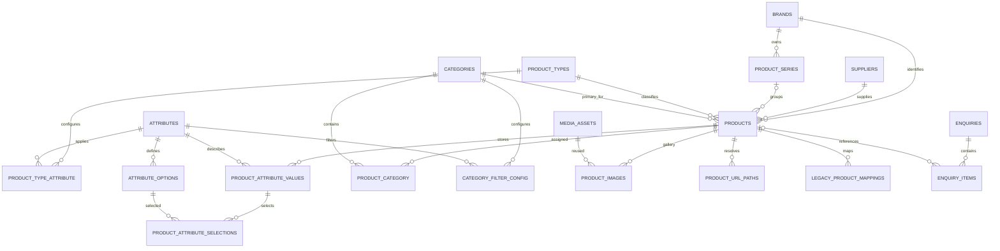

# BE-08.2 — Read-only проект схемы БД и API-контрактов

BE-08.2 выполнен как **read-only проектирование**. Репозиторий сверен с ADR; ниже — проект схемы, ERD, контрактов и решений для согласования. **BE-08.3 не начат.**

Файлы, БД и инфраструктура не изменялись. До и после работы `git status --short` одинаков:

```text
?? docs/backend/BE-08.2_CODEX_SCHEMA_DESIGN.md
```

Это существовавший до начала работы untracked-файл задания. Миграции, seeders, импорт, тесты и сборки не запускались.

> Примечание к сохранению: этот отчёт перенесён из ответа в чате в отдельный файл по последующему запросу владельца. Утверждения о read-only и git status относятся к фазе аудита и проектирования до создания настоящего файла.

## 1. Фактическое состояние репозитория

Основной источник целевого поведения — [BE-08_ARCHITECTURE_DECISIONS.md](BE-08_ARCHITECTURE_DECISIONS.md). Предложения ниже не означают утверждения конкретной схемы владельцем.

| Область | Проверенный baseline | Значение для BE-08 |
|---|---|---|
| Category | [Category.php](../../backend/app/Models/Category.php), миграция `2026_10_20_000001_create_categories_table.php` | Есть внутренний bigint ID, уникальные `public_id` и `slug`, SEO, публикация, порядок |
| Category API | [CategoryController.php](../../backend/app/Http/Controllers/Api/CategoryController.php), [api.php](../../backend/routes/api.php) | `/api/v1/categories` и `/categories/{slug}`, envelope `data`, camelCase, только published, `no-store` |
| PDF-каталоги | `Catalogue`, `catalogue_category`, `CatalogueManager`, `CatalogueFileLifecycle` | Существующая many-to-many с Category сохраняется; товарный pivot создаётся отдельно |
| Products backend | Проверены модели, миграции и маршруты | Product, Brand, Supplier, Series, Attribute и Product API отсутствуют |
| Filament | [CategoryResource.php](../../backend/app/Filament/Resources/CategoryResource.php) | Есть patterns форм, публикации, сортировки, image uploads; slug Category заблокирован после создания |
| SEO preview | [SeoSearchPreview.php](../../backend/app/Filament/Components/SeoSearchPreview.php) | Переиспользовать с product canonical URL |
| Доступ | [User.php](../../backend/app/Models/User.php), `AdminPanelProvider` | Вход в admin требует `is_admin`; отдельная система товарных ролей/permissions в проверенном коде не обнаружена |
| Product DTO и repository | [catalog.ts](../../frontend/src/types/catalog.ts), [repository.ts](../../frontend/src/lib/catalog/repository.ts) | Товары читаются из `catalog.mock`; Category и PDF-каталоги уже используют API |
| Фильтры | [domain.ts](../../frontend/src/lib/catalog/domain.ts), `CatalogListing.tsx` | Жёстко заданы `material/color/size/usage`; значения — строки; OR внутри фильтра, AND между фильтрами |
| Карточки | `CatalogCard.tsx`, `ProductCardDetails.tsx` | Дизайн можно сохранить; URL сейчас собирается через статическое соответствие Category ID → slug |
| Product page | [page.tsx](../../frontend/src/app/shop/[category]/[slug]/page.tsx) | Поиск по slug, metadata/canonical, `noindex`; Primary Category имеет fallback |
| Gallery | `ProductGallery.tsx`, `product-detail.ts` | Есть галерея с порядком, но нет независимого главного изображения |
| Redirects | `/product/[slug]`, `/[category]`, product page | Используется `permanentRedirect`; локальный исходник Next.js подтверждает статус 308, тогда как ADR требует 301 |
| Product SEO | Проверены product page, Next config и исходники | Product JSON-LD и frontend sitemap не найдены; история product URL отсутствует |
| Cart | [domain.ts](../../frontend/src/lib/enquiry/domain.ts), `store.ts`, `lines.ts` | Хранит `productId + sku + quantity`, но объединение, изменение и удаление строк работают по SKU; resolution использует fixtures |
| Enquiry backend | [StoreEnquiryRequest.php](../../backend/app/Http/Requests/StoreEnquiryRequest.php), `EnquirySubmission` | Product/Cart типы описаны, но submission намеренно отклоняет их как unavailable |
| Enquiry snapshots | Миграция `2026_10_22_000003_create_enquiry_pipeline_tables.php` | В `enquiry_items` только identifier, SKU snapshot, quantity, position; Product FK и полный snapshot отсутствуют |
| Telegram | `DeliverEnquiryToTelegram.php` | Есть Contact/Catalogue представление; товарные строки ещё не реализованы |
| Feature flags | `enquiries.client.ts`, `compose.dev.yaml`, формы | Общий flag включён в dev; Product submit отдельно disabled, Cart submit также disabled |
| Home / Solutions | `HomeSections.tsx`, `solutions/repository.ts`, `solutions/domain.ts` | Home featured products отдельно берёт fixtures; Solutions запрашивает до 1000 товаров и использует fixture Product IDs |

Проверка — статическое чтение кода. Состояние реально работающей MariaDB, API и браузера в этой фазе не проверялось.

Расхождения, которые нельзя переносить в реализацию:

- `PROJECT_CONTEXT.md` и `ROADMAP.md` ещё говорят об исследовании «вариантов»; ADR уже исключает ProductVariant.
- Fixtures содержат `priceVerified: false`. По ADR подтверждённые ненулевые OpenCart-цены нельзя массово объявлять непроверенными.
- SKU используется как идентичность строки корзины и для дедупликации рекомендаций. Это несовместимо с допустимыми одинаковыми SKU разных Brand.
- Текущий fallback Primary Category нельзя использовать для опубликованных авторитетных товаров.
- Текущий product redirect принимает несовпадающую категорию без проверки назначения; целевой resolver должен различать назначенную категорию, исторический путь и неизвестный URL.
- Нынешний `permanentRedirect` не обеспечивает требуемый HTTP 301.
- Замена только `catalogRepository` не удалит все runtime product fixtures: отдельно затронуты Home и cart resolution.

## 2. ERD и schema dictionary — предложение

Рекомендую внутренний `BIGINT UNSIGNED` и неизменяемый публичный UUID. Это соответствует уже используемому подходу Catalogue/News/Enquiry. SKU остаётся бизнес-идентификатором внутри Brand.



Условные обозначения словаря:

- Все поля обязательны, кроме явно помеченных `NULL`.
- Самостоятельные новые сущности имеют `id BIGINT UNSIGNED PK` и timestamps.
- `public_id UUID UNIQUE` выдаётся в API как строковое `id`; внутренние FK наружу не передаются.
- Перечислимые значения предлагаются как ограниченные строки с DB CHECK и Laravel validation.
- Приведённые размеры и precision — предложения до согласования.

| Таблица | Поля |
|---|---|
| `brands` | `id`, `public_id`, `name VARCHAR(255)`, `is_active BOOLEAN DEFAULT true`, timestamps |
| `suppliers` | `id`, `public_id`, `name VARCHAR(255)`, `is_active BOOLEAN DEFAULT true`, timestamps |
| `product_series` | `id`, `public_id`, `brand_id FK`, `name VARCHAR(255)`, `is_active BOOLEAN DEFAULT true`, timestamps |
| `product_types` | `id`, `public_id`, `code VARCHAR(64) UNIQUE`, `name VARCHAR(255)`, `is_active BOOLEAN`, timestamps |
| `products` | `id`, `public_id`, `brand_id FK`, `supplier_id FK`, `product_type_id FK`, `series_id FK NULL`, `sku VARCHAR(100)`, `name VARCHAR(255)`, `description_heading VARCHAR(255) NULL`, `description_paragraphs JSON NULL`, `price_aed DECIMAL(15,4) NULL`, `status VARCHAR(16) DEFAULT draft`, `primary_category_id NULL`, `slug VARCHAR(255)`, `is_featured BOOLEAN DEFAULT false`, `sort_order INT UNSIGNED DEFAULT 0`, `primary_image_id NULL`, `seo_title_override VARCHAR(255) NULL`, `seo_description_override TEXT NULL`, `og_media_asset_id FK NULL`, timestamps |
| `product_category` | `product_id FK`, `category_id FK`, составной PK |
| `attributes` | `id`, `public_id`, `code VARCHAR(64) UNIQUE`, `name VARCHAR(255)`, `value_type VARCHAR(16)`, `unit_code VARCHAR(32) NULL`, `display_precision TINYINT UNSIGNED NULL`, `sort_order INT UNSIGNED`, `is_active BOOLEAN`, timestamps |
| `product_type_attribute` | `product_type_id FK`, `attribute_id FK`, `is_required BOOLEAN`, `is_filterable BOOLEAN`, `sort_order INT UNSIGNED`, составной PK |
| `attribute_options` | `id`, `attribute_id FK`, `code VARCHAR(64)`, `label VARCHAR(255)`, `label_key VARCHAR(255)`, `sort_order INT UNSIGNED`, `is_active BOOLEAN`, timestamps |
| `product_attribute_values` | `product_id FK`, `attribute_id FK`, `value_type VARCHAR(16)`, `text_value TEXT NULL`, `number_value DECIMAL(18,6) NULL`, `boolean_value BOOLEAN NULL`, PK `(product_id, attribute_id)` |
| `product_attribute_selections` | `product_id`, `attribute_id`, `option_id`, PK по трём полям |
| `category_filter_config` | `category_id FK`, `attribute_id FK`, `control_type VARCHAR(16)`, `is_visible BOOLEAN`, `sort_order INT UNSIGNED`, PK `(category_id, attribute_id)` |
| `media_assets` | `id`, `public_id`, `disk VARCHAR(32)`, `path VARCHAR(512)`, `mime_type VARCHAR(100)`, `size_bytes BIGINT UNSIGNED`, `width INT UNSIGNED NULL`, `height INT UNSIGNED NULL`, `sha256 CHAR(64) NULL`, timestamps |
| `product_images` | `id`, `public_id`, `product_id FK`, `media_asset_id FK`, `position INT UNSIGNED`, `alt_override VARCHAR(255) NULL`, timestamps |
| `product_url_paths` | `id`, `product_id FK`, `path VARCHAR(600) UNIQUE`, `kind VARCHAR(24)` — `canonical/history/compatibility`, timestamps |
| `legacy_product_mappings` | `id`, `source VARCHAR(64)`, `legacy_product_id BIGINT UNSIGNED`, `product_id FK`, `source_checksum CHAR(64) NULL`, timestamps |

`legacy_product_mappings` — проект границы интеграции, а не разрешение на импорт. Ошибочные/неразрешённые legacy-записи не требуют создания фиктивного Product: они остаются в отчёте исключений будущего импортёра.

Для существующих `enquiry_items` предлагаются будущие добавления:

| Поле | Назначение |
|---|---|
| `product_id BIGINT UNSIGNED NULL FK` | Ссылка на текущий товар; при допустимом удалении `SET NULL` |
| `product_snapshot JSON NULL` | Версионированный неизменяемый snapshot |
| Существующие `product_identifier`, `sku_snapshot` | Сохраняются для совместимости и истории |

Новые товарные заявки обязаны иметь полный snapshot; nullable нужен для совместимости с существующей структурой, а не для разрешения неполных новых записей.

### Ограничения и индексы

| Область | Предлагаемая защита |
|---|---|
| Product identity | `UNIQUE(public_id)`, неизменяемость в Laravel |
| Brand + SKU | Обязательный `UNIQUE(brand_id, sku)`; collation зависит от решения о нормализации |
| Product slug | Рекомендация: глобальный `UNIQUE(slug)` для однозначного `/product/{slug}` |
| Series Brand | `UNIQUE(product_series.id, brand_id)` и составной FK из `(products.series_id, products.brand_id)` |
| Primary Category | Составной FK `(products.id, primary_category_id)` → `product_category(product_id, category_id)` |
| Primary image | Составной FK `(products.id, primary_image_id)` → `product_images(product_id, id)`; нужен соответствующий UNIQUE |
| Price | CHECK `price_aed IS NULL OR price_aed > 0` |
| Published | CHECK требует непустой `primary_category_id`; остальные publish checks — сервис |
| Attribute type | `value_type` только `text/number/select/multiselect/boolean`; составной FK значения на `(attributes.id, value_type)` |
| Typed value | CHECK разрешает только соответствующую scalar-колонку; для select/multiselect scalar-колонки пусты |
| Selected option | FK на родительское значение и составной FK `(option_id, attribute_id)` на option той же характеристики |
| Option uniqueness | `UNIQUE(attribute_id, code)`, `UNIQUE(attribute_id, label_key)` |
| Media reuse | `UNIQUE(disk, path)`; `UNIQUE(product_id, media_asset_id)` в галерее |
| URL reservation | Уникальный полный путь; не более одной canonical-записи на Product через nullable generated key + UNIQUE |
| Legacy identity | `UNIQUE(source, legacy_product_id)` |

Начальные индексы выборок:

- `products(supplier_id, status)`;
- `products(status, price_aed, id)`;
- `products(series_id, status, sort_order, id)`;
- `products(brand_id)`, `products(product_type_id)`;
- `product_category(category_id, product_id)`;
- `product_attribute_values(attribute_id, number_value, product_id)`;
- `product_attribute_values(attribute_id, boolean_value, product_id)`;
- `product_attribute_selections(attribute_id, option_id, product_id)`;
- `category_filter_config(category_id, is_visible, sort_order)`;
- `product_images(product_id, position, id)`.

Окончательный набор индексов проверяется по реальным запросам и `EXPLAIN` в будущей dev-фазе.

### Транзакционные инварианты

Рекомендую единый `ProductManager` для Filament, будущего импорта и других путей записи. Проверки только в форме недостаточны.

1. Создать draft с nullable primary pointers.
2. Назначить категории, атрибуты и изображения.
3. Установить Primary Category и главное изображение.
4. Проверить публикационные требования.
5. Сохранить итоговое состояние в одной транзакции.

При изменении агрегата блокировать Product. При проверке Supplier/справочников использовать согласованные блокировки; обработку конфликтов и deadlock retry проверить отдельно.

Именно сервис гарантирует:

- применимость Attribute к Product Type;
- обязательность характеристик;
- ровно один option для заполненного `select`, несколько уникальных — для `multiselect`;
- ровно одно главное изображение при непустой галерее;
- ровно один действующий canonical path;
- безопасную смену Primary Category и Product Type;
- отсутствие потери значений при изменении справочников.

FK гарантирует принадлежность primary pointer товару, но **не гарантирует самостоятельно наличие pointer при непустой галерее**.

Для удаления главного изображения сначала выбирается первое оставшееся по `(position, id)`. У последнего изображения pointer становится NULL. Порядок и главное изображение независимы.

Рекомендуемое удаление:

- Brand/Supplier/Type/Series/Category/Attribute/Option/Media, на которые есть ссылки: `RESTRICT`, вместо удаления — архивирование;
- Product: обычная операция — archive; hard delete только для разрешённых draft и с явной очисткой зависимостей;
- product-owned pivots/values/images можно удалять вместе с разрешённым удалением Product;
- исторические URL опубликованных товаров не освобождать для другого товара;
- общий физический файл не удалять при удалении одной связи;
- удаление физического файла — после commit и повторной проверки всех gallery/OG references.

Нужно учитывать циклические primary FK: порядок создания/изменения/очистки задаётся явно, без предположения об отложенной проверке ограничений.

### Eloquent и Filament

Предлагаемые связи Product: `brand`, `supplier`, `productType`, `series`, `categories`, `primaryCategory`, `images`, `primaryImage`, `attributeValues`, `urlPaths`, `legacyMappings`. Category получает `products` и `filterConfigs`, сохраняя `catalogues`.

Filament:

- справочники Brand, Supplier, Series, Product Type, Attribute и Options;
- type↔attribute relation manager с порядком, обязательностью, filterability;
- Product: Identity, Categories, Characteristics, Price, Gallery, SEO;
- Series selector ограничен Brand; несовместимая смена Brand блокируется;
- Primary Category выбирается только среди назначенных;
- категория управляет собственным filter relation manager;
- Product list: Supplier/Brand/Type/status filters, массовое изменение статуса с той же валидацией;
- Supplier toggle влияет на effective visibility без переписывания Product statuses;
- SEO использует существующий `SeoSearchPreview`;
- записи со значениями архивируются; смена типа заполненного Attribute блокируется до отдельного сценария преобразования.

Не предлагается расширение прав доступа сверх существующего admin-only подхода без отдельной потребности.

## 3. Хранение характеристик и SKU

| Альтернатива | Преимущества | Последствия |
|---|---|---|
| JSON на Product | Минимум таблиц, простой перенос | Слабее FK и типизация; динамические числовые фасеты и индексы сложнее |
| Таблица на каждый scalar type + selection pivots | Строгая типизация | Больше таблиц и объединений для чтения полного товара |
| Одна typed-value таблица + selection table | Ограниченная сложность, числовые индексы, FK options | Нужны CHECK и сервисная валидация применимости |

**Рекомендация — третий вариант.** Это ограниченный механизм характеристик Product, без универсального entity/value framework, формул, произвольных вложенных типов и сериализованных массивов option IDs.

Фильтрация — через `EXISTS` по характеристикам и selections. Это позволяет избежать размножения Product rows при нескольких совпадающих options; для facets считать distinct Product.

Единица фиксируется на определении числового Attribute. Например, diameter/width/depth/height — отдельные числовые характеристики с общей согласованной единицей. `Dimensions` собирается из структурированных значений; legacy-строка не считается нормализованным размером. Color и Finish имеют разные Attribute IDs.

«Без изменения кода» означает новые Product Types, характеристики и options в пределах пяти поддержанных типов значений. Новый принципиально иной вид значения потребует разработки.

Для SKU нельзя молча выбрать collation или нормализацию:

| Вариант | Поведение | Риск |
|---|---|---|
| Точное сравнение | Регистр и внутренние пробелы значимы | Визуальные дубли |
| Нормализованный uppercase SKU | Единый SKU хранится и показывается после подтверждения | Изменение legacy-написания |
| Исходный SKU + отдельный normalized key | Сохраняет оригинал | Дополнительная колонка и риск рассинхронизации; UNIQUE нужен по normalized key |

Рекомендую согласовать **единое каноническое представление SKU**: убрать внешние пробелы и нормализовать регистр с явным показом результата администратору. Внутренние пробелы и пунктуацию не переписывать без решения. Допустимый алфавит определить после проверки реальных значений.

Для варианта с каноническим SKU:

- Laravel проверяет уникальность в Brand с исключением текущего Product при редактировании;
- MariaDB имеет `UNIQUE(brand_id, sku)` с явно выбранной collation;
- Filament и импорт используют тот же нормализатор;
- изменение Brand и SKU проверяется как новая пара;
- конкурентный UNIQUE conflict преобразуется в понятную validation error, без SQL в ответе;
- missing SKU не заменяется выдуманным значением: legacy-запись остаётся исключением до разрешения.

## 4. API-контракты и Next.js

Ниже предлагаемый контракт, ещё не существующие endpoints. Публичные GET доступны без авторизации; Supplier наружу не раскрывается.

| Endpoint | Назначение |
|---|---|
| `GET /api/v1/products` | All products; `category=<slug>` ограничивает по назначению в pivot |
| `GET /api/v1/products/filters?category=<slug>` | Определения и доступные значения фильтров |
| `GET /api/v1/products/resolve?path=<relative-path>` | Разрешение canonical, secondary-category, history и `/product/{slug}` |
| `GET /api/v1/products/{publicId}` | Detail по неизменяемой идентичности |
| `GET /api/v1/products/{publicId}/series-products` | Другие видимые товары серии между категориями |
| `GET /api/v1/products/{publicId}/related-products` | Существующий блок рекомендаций |

Статические `filters/resolve` регистрируются перед маршрутом `{publicId}`.

Для cart/Solutions предлагается ограниченная batch-выборка тем же list endpoint: `ids[]=<uuid>`, максимум 100 IDs; неизвестные и скрытые товары отсутствуют в результате. Это исключает зависимость Solutions от `perPage=1000`.

Отдельный Supplier API не нужен. Brand API добавлять только при появлении конкретного публичного потребителя.

### Единая видимость

Все list/detail/facets/series/related/batch/resolver используют один scope:

```text
Product published
AND Supplier active
AND publication requirements satisfied
AND Primary Category publicly available
```

Последний пункт — рекомендация для согласования: товару необходим действующий публичный canonical category URL.

Отключение Supplier немедленно скрывает товары без изменения их `status`. Повторное включение возвращает только товары, сохранившие published и остальные условия. Влияние Brand activity пока открыто.

Category list использует **все назначения**, а не только Primary Category. Detail скрытого товара возвращает 404; redirect не должен раскрывать его новый адрес.

### List DTO

Все данные следующего примера условные, не являются данными OpenCart:

```json
{
  "data": [
    {
      "id": "11111111-1111-4111-8111-111111111111",
      "slug": "example-planter",
      "path": "/shop/example-category/example-planter",
      "name": "Example planter",
      "sku": "EXAMPLE-001",
      "brand": {
        "id": "22222222-2222-4222-8222-222222222222",
        "name": "Example brand"
      },
      "productType": {
        "code": "example-planter",
        "name": "Example planter type"
      },
      "categoryIds": ["example-category-id"],
      "primaryCategoryId": "example-category-id",
      "primaryImage": null,
      "specifications": [
        {
          "code": "height",
          "label": "Height",
          "value": "67.000000",
          "unit": "cm",
          "display": "67 cm"
        }
      ],
      "price": {
        "currency": "AED",
        "amount": "123.4500",
        "mode": "priced"
      }
    }
  ],
  "meta": {
    "total": 1,
    "page": 1,
    "pageCount": 1,
    "perPage": 12,
    "sort": "featured",
    "appliedFilters": {}
  }
}
```

Отсутствующая пригодная цена:

```json
{
  "currency": "AED",
  "amount": null,
  "mode": "on_enquiry"
}
```

`amount` — decimal string, без float в контракте. Нет `priceVerified`, фиктивных stock полей, availability или fastDelivery.

### Detail DTO

Detail содержит все поля карточки и дополнительно:

| Поле | Контракт |
|---|---|
| `categories` | Массив публичных назначенных Category summaries |
| `descriptionHeading` | `string \| null` |
| `descriptionParagraphs` | `string[]`, English |
| `images` | `{id, src, alt, position, isPrimary}[]`, порядок по position |
| `attributes` | Discriminated union по пяти `type` |
| `series` | `{id, name} \| null`, без публичного series path |
| `seo` | `{title, description, ogImage, canonicalPath, indexable}` |

Примеры элементов `attributes`, также условные:

```json
[
  {
    "code": "height",
    "label": "Height",
    "type": "number",
    "value": "67.000000",
    "unit": "cm",
    "display": "67 cm"
  },
  {
    "code": "finish",
    "label": "Finish",
    "type": "select",
    "value": {
      "code": "example-finish",
      "label": "Example finish"
    }
  },
  {
    "code": "usage",
    "label": "Usage",
    "type": "multiselect",
    "value": [
      {
        "code": "example-usage",
        "label": "Example usage"
      }
    ]
  },
  {
    "code": "example-flag",
    "label": "Example flag",
    "type": "boolean",
    "value": false
  },
  {
    "code": "example-note",
    "label": "Example note",
    "type": "text",
    "value": "Example text"
  }
]
```

Незаполненная необязательная характеристика отсутствует в массиве. `false` и допустимый числовой ноль не считаются отсутствием значения.

### Pagination, sorting, filters

Предлагаемые правила до утверждения:

- `page=1`, `perPage=12`, допустимый `perPage` — 1–100.
- `sort=featured|name-asc|name-desc|price-asc|price-desc`.
- Featured: `is_featured DESC, sort_order ASC, id ASC`.
- Цена сортируется как decimal в MariaDB; NULL всегда последним в обоих направлениях.
- Каждая сортировка имеет стабильный tie-breaker.
- Пустой результат: `200`, `data: []`, `total: 0`, `pageCount: 1`.
- Страницу за пределами диапазона предлагается ограничивать последней — соответствует текущему frontend domain.
- Некорректные типы/лимиты/неизвестные API-фильтры — 422.

Query для контролируемых значений:

```text
?category=example-category
&filter[finish][]=example-finish
&filter[finish][]=another-finish
&sort=price-asc
&page=1
&perPage=12
```

OR внутри Attribute, AND между Attributes. Для boolean — `filter[example-flag]=false`. Range-контракт можно зарезервировать как `min[height]` / `max[height]`, но включать только после согласования range UX.

Facet DTO:

```json
{
  "data": [
    {
      "code": "finish",
      "label": "Finish",
      "valueType": "select",
      "control": "checkbox",
      "options": [
        {
          "value": "example-finish",
          "label": "Example finish"
        }
      ]
    }
  ]
}
```

Рекомендация первой версии: facets формируются по всей видимой категории **до текущих пользовательских фильтров**, без counts. Это соответствует нынешнему подходу и не меняет дизайн.

- Порядок и видимость берутся из `category_filter_config`.
- Не показываются фильтры без пригодных значений.
- Учитывается применимость и `is_filterable` в Product Type.
- Разные Attributes с одинаковым label не объединяются.
- Выбор option сравнивается по immutable code, не по label.
- Text не получает публичный свободный фильтр автоматически.

Для `/shop` без категории нужна отдельная договорённость. Рекомендация: объединять только настройки одного и того же Attribute из публичных категорий, сортируя по `attributes.sort_order`; не объединять разные характеристики по названию.

Существующий web query `material=...&color=...` сохраняется через frontend adapter там, где есть явное соответствие реальному Attribute. Старые fixture labels нельзя угадывать как option IDs.

### Ошибки и caching

Для всех новых ответов, включая ошибки, — `Cache-Control: no-store`. Next.js использует существующий `serverApiFetch` с `cache: 'no-store'`.

Сохраняется существующий envelope:

```json
{
  "error": {
    "code": "validation_failed",
    "message": "Check your details.",
    "fields": {
      "sort": ["The selected sort is invalid."]
    },
    "requestId": "33333333-3333-4333-8333-333333333333"
  }
}
```

- 404 — неизвестный/непубличный Product или Category.
- 422 — ошибка query validation.
- 503 — распознанная временная недоступность зависимости.
- 500 — неожиданная ошибка, без внутренних деталей.
- API/SSR failure не превращается в пустой успешный каталог или mock.

Текущий общий exception handler выдаёт `server_error` для необработанных 5xx. Специальную обработку product 503 ещё потребуется реализовать; сейчас её нет.

### Canonical и redirects

Единственный путь:

```text
/shop/{primaryCategorySlug}/{productSlug}
```

Resolver принимает только допустимый относительный product path. Абсолютные URL, `//`, traversal и произвольные redirect targets запрещены.

Условный ответ для старого пути:

```json
{
  "data": {
    "productId": "11111111-1111-4111-8111-111111111111",
    "canonicalPath": "/shop/example-category/example-planter",
    "resolution": "redirect",
    "httpStatus": 301
  }
}
```

Сам resolver возвращает JSON с HTTP 200; **публичный web URL** возвращает HTTP 301 с `Location`.

При смене slug или Primary Category:

- прежний canonical резервируется в history;
- все записи указывают на стабильный Product;
- конечный URL вычисляется из текущего состояния Product;
- цепочки `A → B → C` не создаются;
- конфликт нового URL блокирует изменение;
- `/product/{slug}` сохраняется как compatibility alias;
- вторичный категорийный URL перенаправляется, если категория назначена товару или путь есть в истории;
- неизвестный неназначенный путь возвращает 404.

Для точного 301 понадобится обработка до начала SSR streaming — например, в серверном слое маршрутизации Next.js. Простого вызова текущего `permanentRedirect` недостаточно.

`?product_id=...` и OpenCart aliases принадлежат BE-09. Их нельзя автоматически перенаправлять на категорию.

### SEO, media и series

- Пустой SEO override означает auto; ручное значение не перезаписывается.
- Auto title/description строятся из Name, структурированных Dimensions и Finish. Точные шаблоны ещё согласуются.
- Slug предлагается генерировать при создании; после публикации менять только явно, с URL history.
- `alt_override = NULL` означает auto ALT; непустой override имеет приоритет.
- Auto ALT рассчитывается из актуальных данных и порядка; главное изображение не обязано иметь номер.
- `og_media_asset_id = NULL` означает fallback на главное изображение.
- OG/Twitter используют те же resolved SEO-поля.
- Product JSON-LD использует только реальные данные; Offer — только при пригодной цене, без выдуманного availability, рейтинга или доставки.
- `indexable` остаётся false до готовности каталога и проверенного URL mapping.
- Series endpoint исключает текущий Product по ID, соблюдает effective visibility и не ограничивается текущей Category.
- Блок `Other products in this series` располагается перед существующими рекомендациями. Лимит, сортировка и большие серии требуют решения до frontend-фазы.

### Frontend integration

Сохраняются `CatalogListing`, карточки, Gallery, ProductDescription, drawers и визуальный дизайн. Меняется источник и адаптация данных:

- карточки получают готовый `path`;
- typed attributes адаптируются к строкам существующих specifications;
- главная картинка берётся из `primaryImage`, независимо от порядка галереи;
- decimal price форматируется без потери значимых разрядов;
- удаляются hardcoded Category mapping и fallback Primary Category;
- related products дедуплицируются по Product ID;
- Home featured products переходят на авторитетную выборку;
- Solutions получает товары по явным IDs; текущие fixture IDs требуют проверенного mapping;
- cart resolution перестаёт импортировать fixtures;
- 404 ведёт в `notFound`, недоступность API — в error state, без mock fallback.

### Cart и enquiry snapshot

Будущая версия localStorage:

```json
{
  "version": 2,
  "items": [
    {
      "productId": "11111111-1111-4111-8111-111111111111",
      "quantity": 2
    }
  ]
}
```

Ключ строки — Product ID. Старый SKU может сохраняться как подсказка при переходе, но не участвует в идентичности. Неразрешённые старые записи не удаляются молча и не привязываются по одному SKU.

Минимальный серверный snapshot:

- `schemaVersion`;
- Product public ID;
- Brand public ID и name;
- SKU и name;
- canonical path на момент заявки;
- структурированные dimensions и finish с display labels;
- AED price string либо NULL, price mode;
- quantity и snapshot timestamp.

Snapshot создаётся из заблокированных авторитетных записей в транзакции сохранения enquiry/outbox. Клиентские name/price/attributes не принимаются за источник истины.

Для Product/Cart payload рекомендуется Product ID + quantity; `distinct` по SKU удаляется, `distinct` по Product ID сохраняется. Общие поля и idempotency остаются совместимыми с существующим enquiry API.

Telegram читает исторический snapshot, а не актуальное имя/цену товара. Retry той же заявки не переснимает данные.

**Формы на этом этапе не включаются.**

## 5. OpenCart readiness, открытые решения и риски

Числа ниже взяты из ADR как результаты предыдущего аудита B. Исходный экспорт в этой фазе заново не исследовался; независимое подтверждение этих чисел не заявляется.

| Факт из аудита B | Следствие для проекта |
|---|---|
| 396 товаров, 386 published | Legacy publication не равна разрешению публикации в новой системе |
| 31 без SKU | Ручные исключения; Product без выдуманного SKU не создаётся автоматически |
| Повтор SKU `3075` | Проверка после назначения Brand; межбрендовый повтор допустим, внутри Brand — конфликт |
| 20 IDs 50–69, zero-price/no-description/Color Plastic | Карантин; нельзя автоматически превращать options в Product или публиковать |
| 700 product-category связей, 267 многокатегорийных товаров | Импорт pivot; Primary Category требует явного mapping |
| 3242 attribute rows, 1716 orphan references | Orphans исключить с отчётом; не угадывать владельца |
| 400 ссылок на 369 файлов | Переиспользовать MediaAsset; ALT/main/order хранить в product association |
| 19 product aliases | Недостаточно для полного исторического mapping; требуется BE-09 |
| MyISAM export | Целостность архива не доказывает согласованность snapshot |

Автоматически переносимы только записи с проверенными mappings Brand/Supplier/Type/Category, пригодным SKU, ценой и подтверждёнными преобразованиями характеристик. Ненулевые подтверждённые цены переносятся точно; повторный импорт связывается через legacy mapping, а не SKU.

### Решения, блокирующие окончательную схему

| Решение и вопрос владельцу | Варианты / рекомендация | Последствия и обратимость |
|---|---|---|
| Как сравнивать SKU? | Exact / canonical uppercase / отдельный normalized key. Рекомендую canonical после подтверждения преобразования | Определяет collation и UNIQUE; поздняя смена требует поиска конфликтов |
| Какую точность цены сохранять? | `DECIMAL(...,2)` / `DECIMAL(...,4)`. Предварительно `(15,4)`, после проверки source scale/max | Сужение precision потенциально теряет данные; формат отображения согласуется отдельно |
| Как хранить attributes и размеры? | Три варианта выше; рекомендую typed table, фиксированную unit на Attribute | Смена storage или единиц после наполнения требует миграции |
| Как резервировать URL? | Уникальный slug глобально / в категории; рекомендую глобально плюс registry всех известных путей | Влияет на `/product/{slug}` и возможность повторного использования старых адресов |
| Подходит ли общий MediaAsset? | Прямые file paths / asset + association; рекомендую второй | Определяет FK, OG references и безопасное удаление общих файлов |
| Где хранить физические media? | Существующий public disk / object storage | Рекомендую оставить `disk/path` в схеме; конкретный storage можно менять без изменения Product identity |

### Решения до реализации поведения, но без необходимости менять основу схемы

| Конкретный вопрос | Рекомендация | Что откладывается |
|---|---|---|
| Brand inactivity скрывает товары? | Пока не связывать Brand activity с public visibility без решения; отделить запрет нового выбора от скрытия существующих | Visibility scope; изменение обратимо, но влияет на доступность URL |
| Что происходит с заявками при выключении Supplier? | Новые заявки на скрытые товары отклонять; сохранённые snapshots и deliveries сохранять | Правила приёма и конкурентной проверки |
| Что обязательно для публикации? | Primary Category, валидные справочники/атрибуты; рекомендую хотя бы одно изображение и содержательное описание; цена необязательна | Publish validation |
| Как показывать фасеты и counts? | Первая версия — baseline facets без counts; range отдельно согласовать | Query/DTO и UI tests |
| Как ведут себя фильтры `/shop`? | Объединять только одинаковые Attribute IDs, с общим порядком | All-products integration |
| Какие media formats/limits/conversions? | Использовать текущие uploads как отправную точку, не считать их лимиты утверждёнными для Products | Upload validation и обработка файлов |
| Как сортировать и ограничивать Series? | Детерминированный порядок; конкретный limit и UX согласовать | Endpoint defaults и большой series block |
| Какие точные SEO templates? | Name + Dimensions + Finish, ручные overrides приоритетны | Auto-generation и preview expectations |
| Как обозначать VAT? | Не делать предположений об inclusive/exclusive | Требуется до публичного утверждения price presentation |
| Какую цену фиксировать в enquiry? | Актуальную серверную цену при принятии как информационный snapshot, без обещания неизменной оферты | Текст формы, snapshot policy |
| Что делать с изменившейся/скрытой cart line? | Сохранить строку, показать проблему, требовать разрешения перед отправкой | Cart UX и submission validation |
| Когда включать индексацию и формы? | Только после сквозной приёмки и отдельного решения по окружению | Activation, вне BE-08.2 |

Основные технические риски: несовпадение application/DB SKU comparison, обход `ProductManager`, конкурентное изменение Supplier/галереи, захват исторического URL другим товаром, потеря precision цены, преждевременная активация forms и сохранение скрытых fixture dependencies.

## 6. Последующие небольшие этапы

Последовательность соответствует ADR; это план, не начало реализации:

1. **До BE-08.3:** согласовать schema blockers, публикационные требования и SKU policy.
2. **BE-08.3:** справочники Brand/Supplier/Series/Type/Attribute/Options, связи, admin access и ограничения.
3. **BE-08.4:** Product aggregate, categories, typed values, media, SEO overrides, URL registry, category filters.
4. **BE-08.5:** публичные DTO, visibility scope, list/detail/resolver/facets/series/related API.
5. **BE-08.6:** Next.js integration, Home и Solutions dependencies, canonical/301, metadata/JSON-LD; удаление runtime product fixtures.
6. **BE-08.7:** cart v2, авторитетные snapshots, Telegram representation; включение forms только после приёмки.
7. **BE-08.8:** локальная сквозная приёмка и подготовка dry-run.
8. **BE-09:** реальный legacy mapping, разрешение исключений и отдельно авторизованные migration/production операции.

`PROJECT_CONTEXT.md` и `ROADMAP.md` обновлять отдельным согласованным изменением.

## 7. Проверки и критерии приёмки

| Область | Будущие обязательные проверки |
|---|---|
| MariaDB uniqueness | Одинаковая Brand+SKU запрещена; разные Brand разрешены; выбранные регистр/пробелы; конкурентное создание; смена Brand/SKU |
| FK и aggregate | Primary Category входит в pivot; main image принадлежит Product; Series соответствует Brand; чужая option запрещена |
| Filament | CRUD справочников; архивирование используемых определений; Supplier filter; bulk status; одинаковая валидация через сервис |
| Dynamic attributes | Все пять типов; `false`/zero; required; неприменимые значения; смена Type; запрет разрушительной смены Attribute type |
| Filters | Secondary Category membership; mixed Types; OR/AND; отсутствие пустых facets; Supplier visibility; decimal ranges после согласования |
| Media | Первое главное; reorder не меняет главное; удаление главного/последнего; конкурентные изменения; общий файл не удаляется; manual ALT сохраняется |
| Prices | Точный перенос decimal; NULL → enquiry; zero отклонён; сортировка NULL-last; отсутствие blanket `priceVerified=false` |
| SEO/URLs | Manual override; смена slug/Primary Category; прямой 301 без цепочек; конфликт старого пути; скрытый target; compatibility route |
| API/SSR | Success/empty/422/404/503; `no-store`; без mock fallback; SSR после изменения данных без rebuild |
| Series/related | Cross-category siblings; исключение по ID; одинаковые SKU разных Brand не теряются |
| Cart/enquiry | Stable-ID identity; v1 transition; недоступные строки сохраняются; authoritative snapshots; idempotency; исторические Telegram retries |
| Migration | Missing SKU, `3075`, IDs 50–69, orphan attributes, shared media, неполные aliases, идемпотентность mappings |
| Regression | Category API, PDF CTA/downloads, Contact enquiries, News, Solutions, сохранение публичного дизайна |

Без записи в этой фазе выполнены чтение исходников, сопоставление контрактов и начальный/конечный `git status`. Проверки ограничений MariaDB, CRUD, конкурентности, API/SSR и импорта требуют будущей реализации и отдельной dev-верификации.

Все application checks в будущем — только через Compose. Laravel feature tests — исключительно в `backend` с `potsandplanters_test`, согласно AGENTS.md; frontend typecheck/build/regression suites — в `frontend`.

**Итоговый статус:** существующий код проверен статически; схема, ERD и API выше спроектированы, но не реализованы и не проверены исполнением. Работа остановлена перед BE-08.3.
